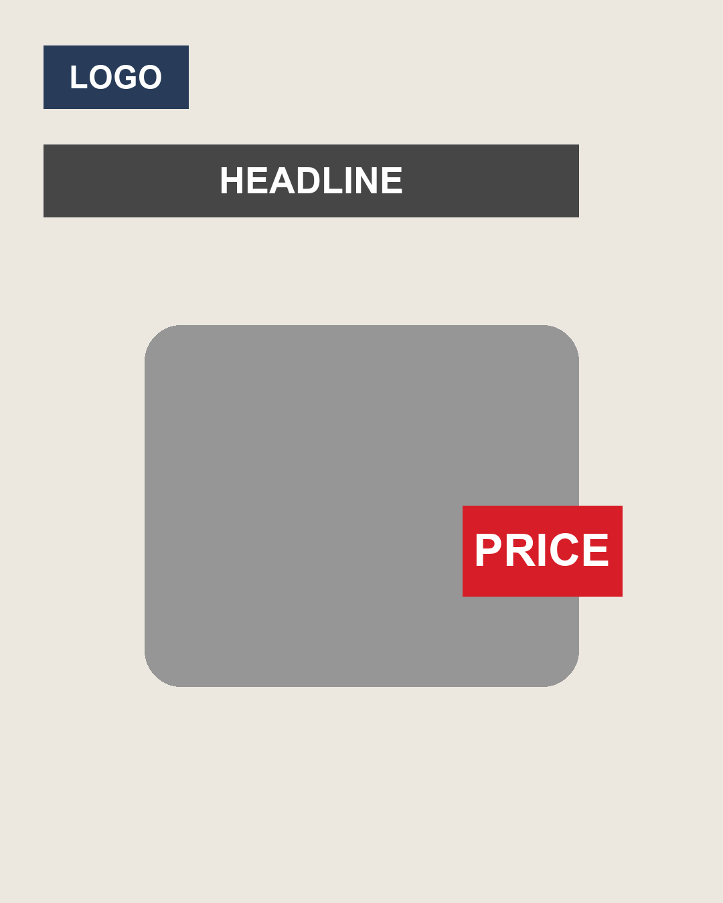

# Where should the promo price go?

**Research question:** where should the promo price go on a furniture ad so that it is noticed and remembered, without reducing attention on the product?

We test several versions of one ad that are identical except for the position of the price tag. Version A has the price in the usual place and is the baseline. The best version is the one where the price gets more attention **while the product keeps its share**.

This repository is the DeepGaze IIE part of a group coursework (CW2). DeepGaze is a free research model that predicts where people are likely to look at an image. Two commercial tools are used alongside it, and all three feed one shared table.

> **Predicted attention, not real eye-tracking.** Every number and heatmap here comes from a model. It says nothing about memory or about real viewers.

> **No results yet.** The real ads do not exist yet. Every picture below is from grey-box placeholder images, marked **PLACEHOLDER – not results**.

More: [what the study does and does not claim](docs/METHOD.md) · [why each choice was made](docs/DECISIONS.md)

## What you get

**All versions side by side.** Brighter means more predicted attention. Each box shows its share of it.


**For each version:** the image, the areas we measure, the predicted heatmap, and the share of attention in each area.

| 1. Image | 2. Areas to measure | 3. Heatmap | 4. Share per area |
|:---:|:---:|:---:|:---:|
|  |  |  |  |

**The answer to the question**, version by version against the baseline (placeholder values):

| Version | Price share | Change vs A | Product change vs A | Verdict |
|---|---|---|---|---|
| B | 15.4% | −0.7 points | +2.8% | price not up; product held |
| C | 37.9% | +21.8 points | −3.0% | price up; product held |

It also writes the tables behind these, a written summary, and the shared table for all three tools.

More: [every output explained, with examples](docs/ANALYSIS_GUIDE.md) · [how each number is calculated](docs/METHOD.md)

## Set it up

You need Python 3.13, git and [`just`](https://github.com/casey/just) (a small tool that gives the commands short names).

| System | What to do |
|---|---|
| macOS | `brew install just python@3.13`, then the commands below |
| Linux | Install Python 3.13, git and `just` with your package manager, then the commands below |
| Windows | Install WSL (`wsl --install` in PowerShell), open Ubuntu, then follow the Linux steps inside it |

```bash
git clone https://github.com/00017501/glancelab-deepgaze-attention.git
cd glancelab-deepgaze-attention
just setup    # installs everything; takes a few minutes
just demo     # runs the whole thing on the placeholder images
```

The first run downloads the model (about 1 GB). It has been run on macOS only so far.

More: [setup step by step for each system](docs/SETUP.md)

## Use it

| Command | What it does |
|---|---|
| `just preview` | Draws the measured areas on each image so you can check them |
| `just validate` | Checks the images and areas, then locks the areas |
| `just run` | Runs the model and makes the heatmaps and tables |
| `just compare` | Compares every version with the baseline |
| `just report` | Writes the summary and the shared table |
| `just demo` | Does all of the above on the placeholder images |

`just` on its own lists every command. The areas are locked before the model runs, so no box can be adjusted after a heatmap has been seen.

More: [using it on the real ads, step by step](docs/ANALYSIS_GUIDE.md) · [making the area files](docs/AOI_GENERATION.md)

## What is where

| Folder | What is in it |
|---|---|
| `data/` | The real study: put the ad images and area files here |
| `examples/placeholder/` | The placeholder study and its example outputs |
| `docs/` | The guides and the method |
| `updates/` | Status updates for the group |
| `src/`, `tests/` | The code and its tests |

Results land in an `output/` folder inside the study: `data/output/` for the real ads.

More: [which file comes from which step](docs/ANALYSIS_GUIDE.md#where-everything-ends-up)

## AI use

Parts of this repository were built with AI assistance, and an AI can propose the measured areas for a person to check. Every such step is listed.

More: [AI use and prompts](docs/AI_USE_AND_PROMPTS.md)

## Licence and reference

MIT, see [LICENSE](LICENSE).

Linardos, A., Kümmerer, M., Press, O. and Bethge, M. (2021) 'DeepGaze IIE: Calibrated prediction in and out-of-domain for state-of-the-art saliency modeling', *ICCV 2021*. Code: <https://github.com/matthias-k/DeepGaze>
