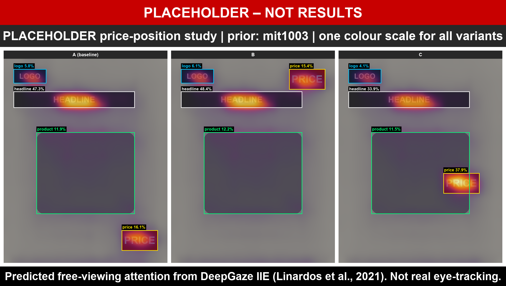
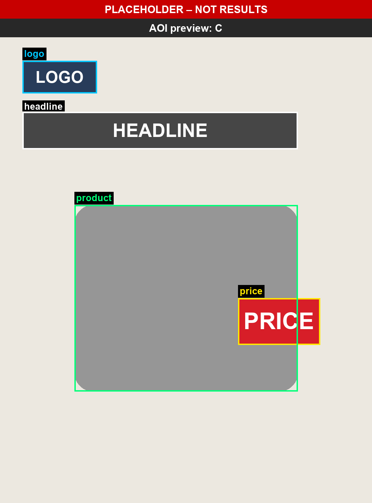
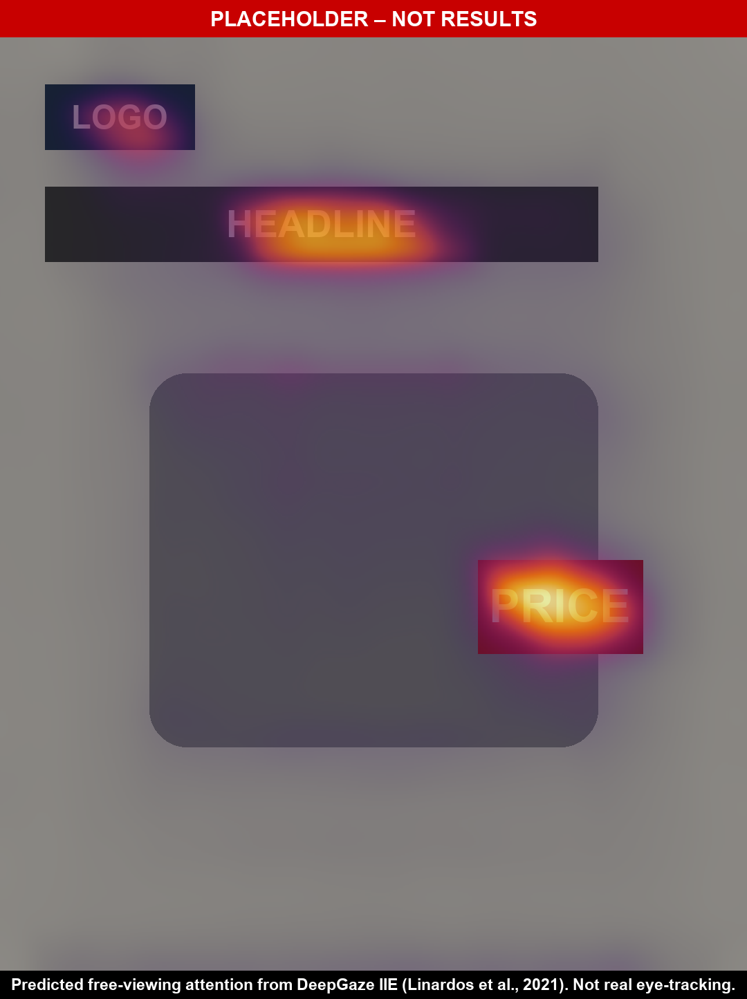
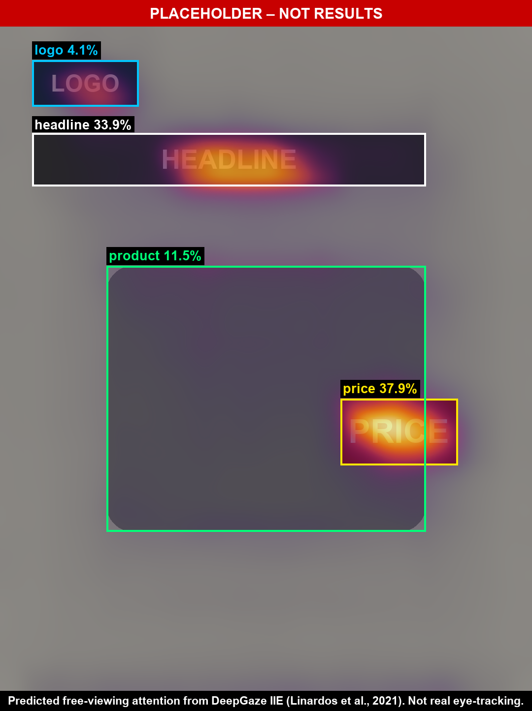

# Price-position attention study: DeepGaze IIE pipeline

Predicted attention for several versions (A, B, C, ...) of one static furniture ad that are identical
except for where the promo price tag sits. Research question: *where should the promo price go so it
is noticed and remembered, without reducing attention on the product?*

This is a placement decision with a trade-off, tested in a structured way:

- Version A is the conventional price position and the baseline. The other versions move the price
  to positions expected to draw more attention to it.
- The best version is the one where the price gains predicted attention **while the product keeps
  its share**. A price that pulls attention off the product counts as a bad result, however much
  attention the price itself gets.
- The study does **not** claim that the price is under-noticed in the advertiser's current ads:
  there is no data on those. A is a reference point for the comparison, not a diagnosis.
- This tool speaks to *noticed* only. *Remembered* needs the group's other evidence.

> **Caveat.** Every number and heatmap here is *predicted* free-viewing attention from DeepGaze IIE
> (Linardos et al., 2021). They are not eye-tracking measurements of real viewers, and they say
> nothing about memory, viewing goals or the context the ad appears in.

> **Status.** The real ads do not exist yet. The only outputs in this repository come from generated
> grey-box images in [`examples/placeholder/`](examples/placeholder/). Every one of them is marked
> **PLACEHOLDER – not results** and must never be reported.

DeepGaze is one of three attention tools in the group project (CW2). The other two are commercial and
their numbers are exported by hand; this pipeline writes one long-format table
(`cross_tool_long.csv`) with the DeepGaze rows filled in and empty rows for the other tools.

## What it looks like

The pictures below are from the placeholder study (grey boxes, not ads). They show what the pipeline
produces; they are not results.

**All versions side by side, on one colour scale.** Brighter means more predicted attention; each
box shows its share of it.



**The steps for one version**: the image, the AOI boxes fixed before the model runs, the predicted
heatmap, and the heatmap with each box's share.

| 1. Image | 2. AOI boxes (`just preview`) | 3. Heatmap (`just run`) | 4. Shares per AOI |
|:---:|:---:|:---:|:---:|
|  |  |  |  |

**The key test** (`just compare`): against baseline A, did the price gain attention and did the
product keep its share? Placeholder values:

| Version | Price share | Change vs A | Product change vs A | Verdict |
|---|---|---|---|---|
| B | 15.4% | −0.7 points | +2.8% | price share not up; product held |
| C | 37.9% | +21.8 points | −3.0% | price share up; product held |

Every step with an example of its output: [docs/ANALYSIS_GUIDE.md](docs/ANALYSIS_GUIDE.md).

## Layout

| Path | What it is |
|---|---|
| `src/glance_attention/` | The pipeline and its command line |
| `examples/placeholder/` | Placeholder study: generated images, AOI files and marked outputs |
| `data/` | The real study goes here: `study.toml`, `images/`, `aois/` |
| `prompts/aoi/annotation.txt` | Prompt used when an AI proposes AOI boxes |
| `provenance/aois/` | AI AOI proposals and their audit records |
| `docs/` | [METHOD](docs/METHOD.md), [DECISIONS](docs/DECISIONS.md), [AI_USE_AND_PROMPTS](docs/AI_USE_AND_PROMPTS.md), [ANALYSIS_GUIDE](docs/ANALYSIS_GUIDE.md), [AOI_GENERATION](docs/AOI_GENERATION.md) |
| `justfile` | Short commands for everything below |
| `setup.sh`, `requirements*.txt`, `patches/` | Pinned environment |
| `tests/` | Tests; all but one run without the model |

A **study** is a folder holding `study.toml`, `images/` and `aois/`. Each image file is one variant,
named by its file name (`A.png` is variant `A`), with a matching `aois/A.json`. Nothing in the code
names a variant, a file or an image size.

## Setup (macOS or Linux, CPU, Python 3.13)

Commands are run with [`just`](https://github.com/casey/just), a small command runner
(`brew install just`).

```bash
just setup        # venv, pinned packages, DeepGaze at a pinned commit, dev tools (safe to rerun)
just test         # seconds, no model
just test-slow    # runs the real model once
```

The first model run downloads the pretrained weights (1-2 GB) into the torch cache.

## Use

`just` on its own lists every command. Each one takes the study folder as an optional last argument;
the default is `data`, the real study.

```bash
just preview      # draw the AOI boxes on the images; list them in pixels and %
just validate     # check images and AOIs, then lock the AOIs
just run          # run the model; needs locked AOIs
just compare      # deltas against the baseline and the key test
just report       # report.md and cross_tool_long.csv
```

```bash
just analyse                     # run, compare and report in one go (validate and commit the lock first)
just run examples/placeholder    # any command on another study folder
just demo                        # the whole placeholder flow, start to finish
```

Helpers:

```bash
just aoi-propose A    # an AI proposes AOI boxes for variant A (needs ANTHROPIC_API_KEY)
just aoi-apply A      # adopt a reviewed proposal as aois/A.json
just rerun            # recompute tables and images from saved model output, without the model
just placeholder      # regenerate the placeholder images and AOI files
just check            # format, lint and fast tests
```

Without `just`: run `./setup.sh` and `.venv/bin/pip install -r requirements-dev.txt`, then each
command is `.venv/bin/python -m src.glance_attention <command> --study <folder>` (`aoi propose A`
and `run --skip-model` for the helpers).

To swap in the real ads, follow [docs/ANALYSIS_GUIDE.md](docs/ANALYSIS_GUIDE.md). No code changes
are needed: replace the files and edit `study.toml`.

## What comes out (`<study>/output/`)

| File | Content |
|---|---|
| `heatmaps/<variant>_heatmap.png`, `<variant>_aoi.png` | Heatmap, and heatmap with AOI boxes and shares |
| `panel.png`, `panel_no_centerbias.png` | All variants side by side on one colour scale |
| `<variant>_aoi.csv`, `summary.csv` | Per-AOI and whole-image metrics, both priors |
| `compare.csv`, `verdict.csv` | Deltas against the baseline; price-up / product-held test |
| `jitter.csv`, `jitter_stability.csv` | Robustness to slightly different AOI boxes |
| `cross_tool_long.csv` | `tool, variant, aoi, metric, value, scale, run_date, version` |
| `report.md` | Everything above in one readable page |
| `run_log.json` | Model version, settings, image and AOI hashes, date, commit |
| `preview/` | AOI boxes on the plain images, and `aoi_boxes.csv` in pixels and % |

Metric definitions are in [docs/METHOD.md](docs/METHOD.md).

## Licence and references

MIT, see [LICENSE](LICENSE).

- Linardos, A., Kümmerer, M., Press, O. and Bethge, M. (2021) 'DeepGaze IIE: Calibrated prediction
  in and out-of-domain for state-of-the-art saliency modeling', *ICCV 2021*.
- DeepGaze code: https://github.com/matthias-k/DeepGaze (pinned commit in `setup.sh`).
