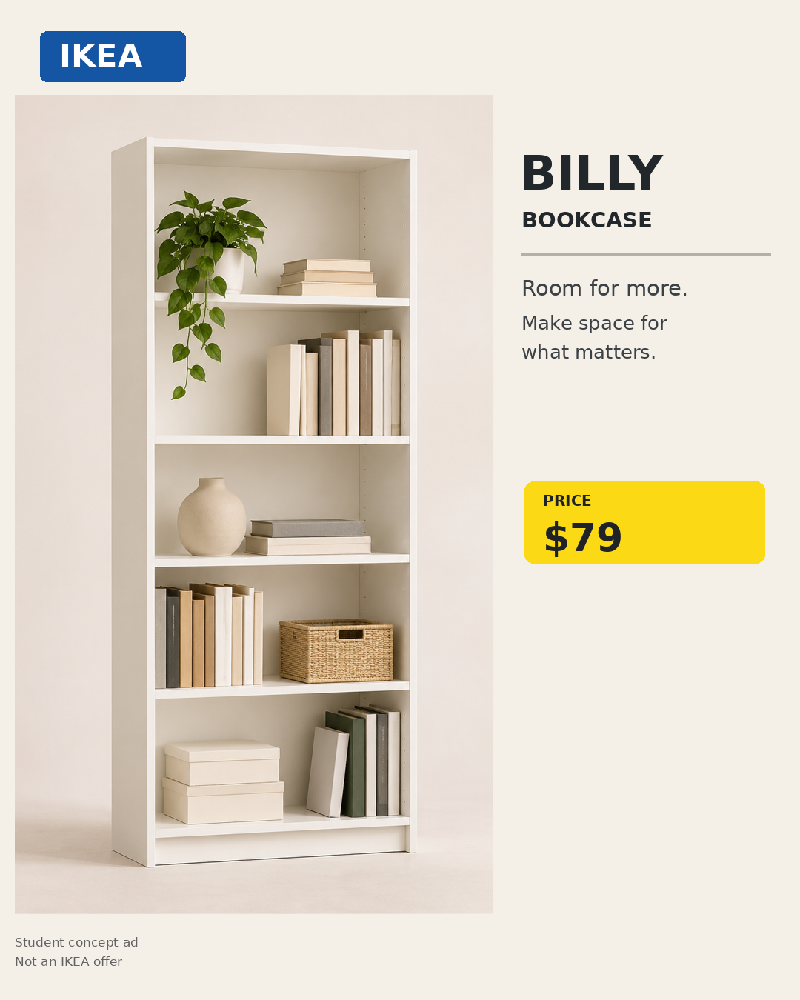
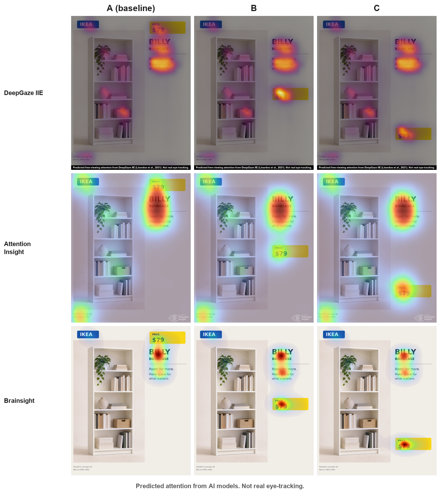

<div align="center">

# Where should the promo price go?

Predicted attention for three versions of one furniture ad that differ only in where the price tag sits, compared across three attention models

[The ads](#the-ads) · [Results](#results) · [The three models](#the-three-models) · [Run it yourself](#run-it-yourself) · [Documents](#documents)

</div>

<table align="center">
  <tr>
    <td align="center">
      <br>
      <sub><b>RESEARCH QUESTION</b></sub>
      <h3>Where should the promo price go so that it is noticed and remembered,<br>without reducing attention on the product?</h3>
    </td>
  </tr>
</table>

> [!WARNING]
> **Predicted attention, not real eye-tracking.** Every number and heatmap here comes from an AI model. No one was shown these ads, and nothing here says anything about memory or real viewers.

This repository does two things:

1. **Runs DeepGaze IIE**, a free research model, on the ad versions and measures the share of predicted attention in each area of the ad.
2. **Compares that with two commercial tools**, Attention Insight and Brainsight, given the same images and the same areas.

It supports a group coursework report (CW2).

## The ads

One ad for a bookcase. Only the yellow price tag moves: top right (A, the baseline), middle right (B) or bottom right (C).

| A (baseline) | B | C |
|:---:|:---:|:---:|
|  |  |  |

Five areas are measured in every version: price, product, logo, headline and tagline. They were locked before any model ran, so no box could be adjusted to suit a result.


**Read more →** [the ad versions](results/2026-11-23/1_ads/README.md) · [the measured areas](results/2026-11-23/2_aois/README.md)

---

## Results

### The short answer

- **C is the only version where the price gains predicted attention in all three models.**
- **B gains the most in DeepGaze but fails the test**: the product loses about a fifth of its attention.
- **The models disagree on the product.** Brainsight says it holds, Attention Insight says it drops in both B and C, DeepGaze says it drops only in B.
- **The DeepGaze gain depends on its centre bias.** With the bias switched off, neither B nor C beats A.

The evidence leans towards C, and it is not strong.

### Heatmaps from the three models

Each row is one model, each column one version. Warmer means more predicted attention. Each model has its own colour scale, so compare along a row, not down a column.



### The numbers

Share of predicted attention, in %. A version passes when the price share goes up **and** the product keeps at least 90% of its share in A.

| Model | Price A / B / C | Product A / B / C | B passes? | C passes? |
|---|:---:|:---:|---|---|
| **DeepGaze IIE** | 5.9 / 20.1 / 11.2 | 29.6 / 24.0 / 27.1 | no: price up, product −19% | **yes**: price up, product −8% |
| **Attention Insight** | 6 / 5 / 8 | 24 / 20 / 19 | no: price not up, product −17% | no: price up, product −21% |
| **Brainsight** | 10 / 12 / 13 | 28 / 27 / 28 | **yes**: price up, product −4% | **yes**: price up, product 0% |

<sub>Predicted values, not eye-tracking. The commercial tools report whole percentages, so a change of 1 to 3 points is weak evidence.</sub>

**Read more →** [all results, folder by folder](results/2026-11-23/README.md) · [every area in every model](results/2026-11-23/6_all_tools/README.md)

---

## The three models

| Model | Type | What it adds | Its guide |
|---|---|---|---|
| **DeepGaze IIE** | Open-source, peer-reviewed | Exact values, and a centre bias that can be switched off | [3_deepgaze](results/2026-11-23/3_deepgaze/README.md) |
| **Attention Insight** | Commercial | Widely used for ad pre-testing | [4_attention_insight](results/2026-11-23/4_attention_insight/README.md) |
| **Brainsight** | Commercial | A predicted viewing order | [5_brainsight](results/2026-11-23/5_brainsight/README.md) |

When reading across models:

- **Compare directions, not values.** Each model scales attention its own way.
- **Within one model, compare versions.** That is what the design supports.

The DeepGaze panel below shows each area's share on the heatmap, with the centre bias on.


**Read more →** [how each number is calculated, and the limits](docs/METHOD.md) · [why each choice was made](docs/DECISIONS.md)

---

## Run it yourself

**You need:** Python 3.13, git and [`just`](https://github.com/casey/just). On macOS: `brew install just python@3.13`. Other systems: [setup guide](docs/SETUP.md).

```bash
git clone https://github.com/00017501/glancelab-deepgaze-attention.git
cd glancelab-deepgaze-attention
just setup    # installs everything; takes a few minutes
just demo     # runs the whole flow on grey-box placeholder images
```

The first run downloads the model (about 1 GB). It has been run on macOS only so far.

To rerun the real study in `data/`:

| Step | Command | What it does |
|:---:|---|---|
| 1 | `just preview` | Draws the measured areas on each image so you can check them |
| 2 | `just validate` | Checks the images and areas, then locks the areas |
| 3 | `just run` | Runs DeepGaze and makes the heatmaps and tables |
| 4 | `just compare` | Compares every version with the baseline |
| 5 | `just report` | Writes the summary and the cross-model table |

The commercial tools are web services, so their results were collected by hand and saved in `data/external/`.

**Read more →** [the analysis, step by step](docs/ANALYSIS_GUIDE.md) · [making the area files](docs/AOI_GENERATION.md)

---

## What is where

| Folder | What is in it |
|---|---|
| `results/2026-11-23/` | The results in one readable folder, with a guide per model |
| `data/` | The real study: ad images, area files, DeepGaze outputs, and the commercial tools' exports in `external/` |
| `examples/placeholder/` | A placeholder study, every output marked PLACEHOLDER |
| `docs/` | The guides and the method |
| `src/`, `tests/` | The code and its tests |

---

## Documents

| Document | Read it when you want to |
|---|---|
| [Results](results/2026-11-23/README.md) | See what the three models say, with the evidence |
| [Method](docs/METHOD.md) | Know how each number is calculated, and the limits |
| [Decisions](docs/DECISIONS.md) | Know why each choice was made |
| [Analysis guide](docs/ANALYSIS_GUIDE.md) | Run the study and see what every step produces |
| [AOI generation](docs/AOI_GENERATION.md) | Make the files that say which areas are measured |
| [Setup](docs/SETUP.md) | Install it on macOS, Linux or Windows |
| [AI use and prompts](docs/AI_USE_AND_PROMPTS.md) | See which steps were AI-assisted, and how |

---

<sub>MIT licence, see [LICENSE](LICENSE). Model: Linardos, A., Kümmerer, M., Press, O. and Bethge, M. (2021) 'DeepGaze IIE: Calibrated prediction in and out-of-domain for state-of-the-art saliency modeling', <i>ICCV 2021</i>. Code: <a href="https://github.com/matthias-k/DeepGaze">github.com/matthias-k/DeepGaze</a></sub>
