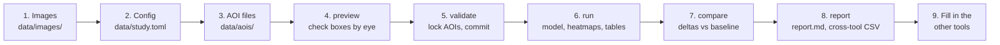
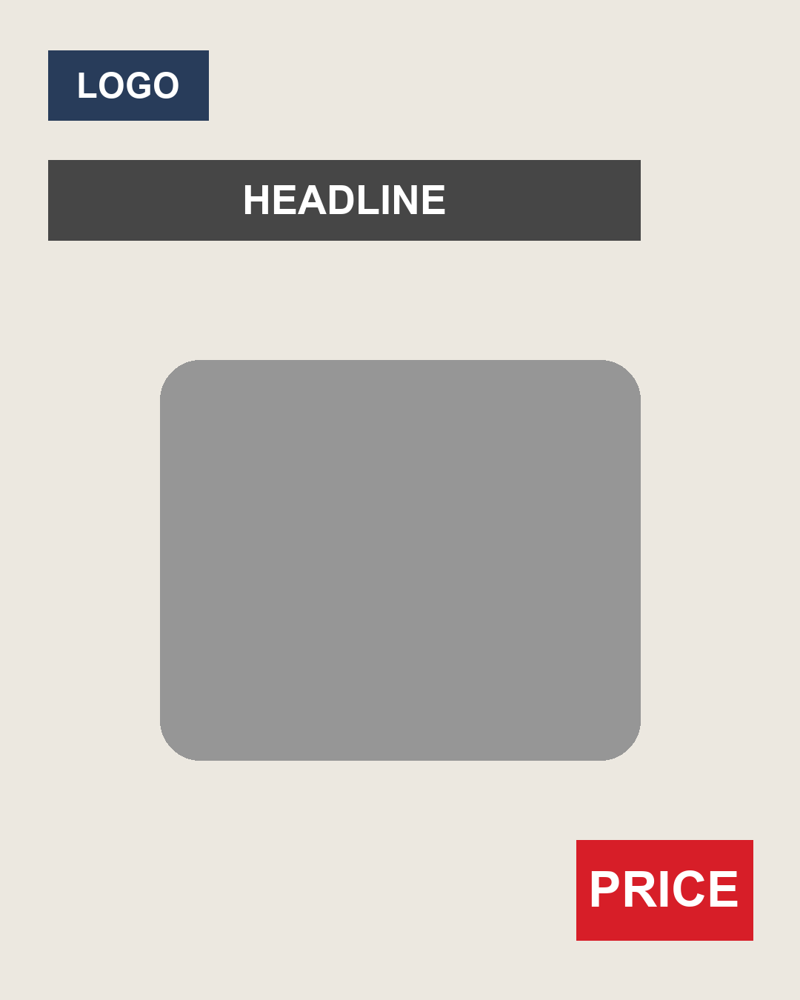
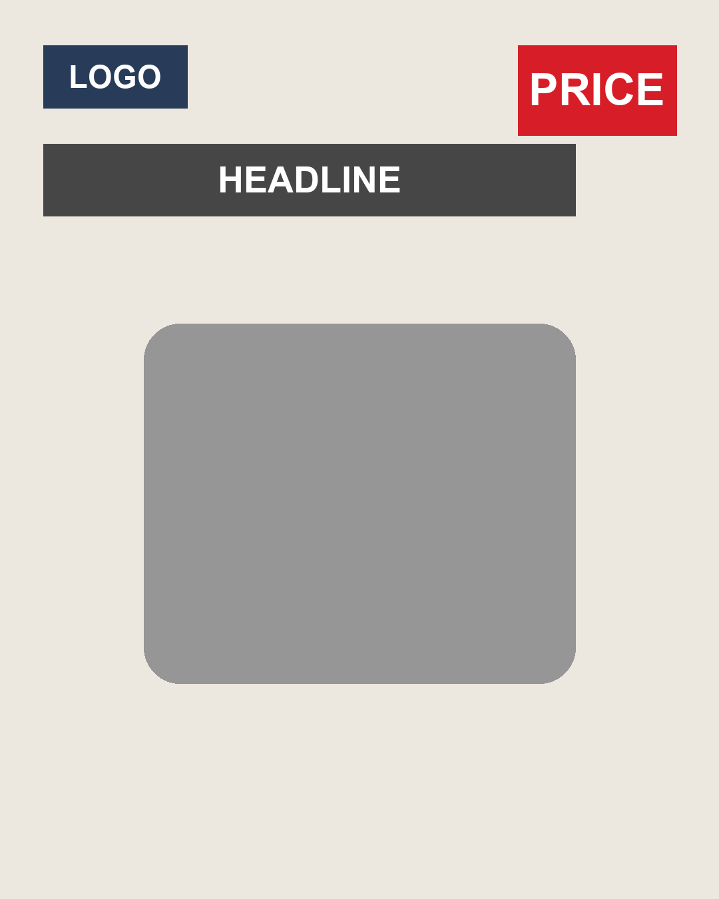
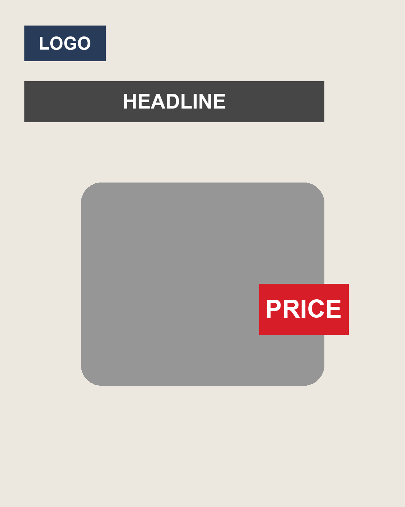
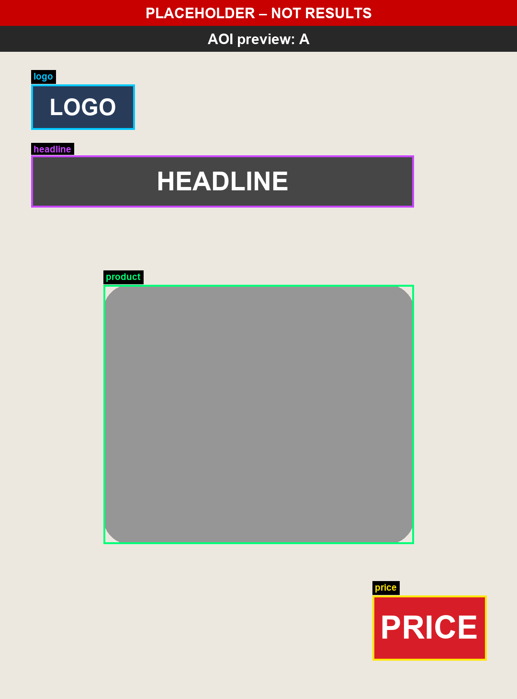
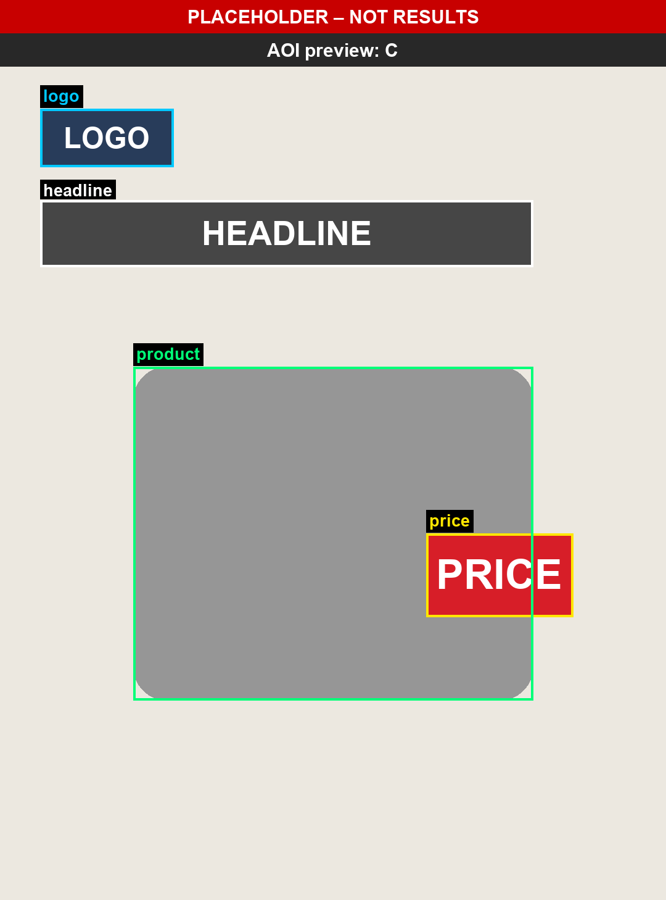
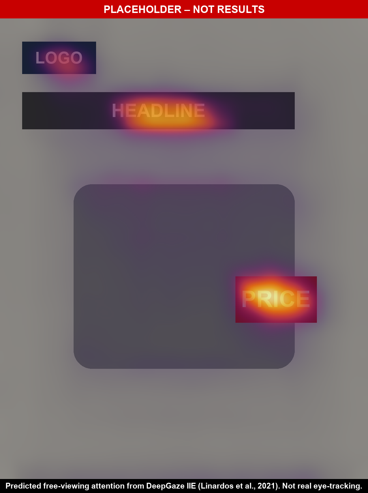
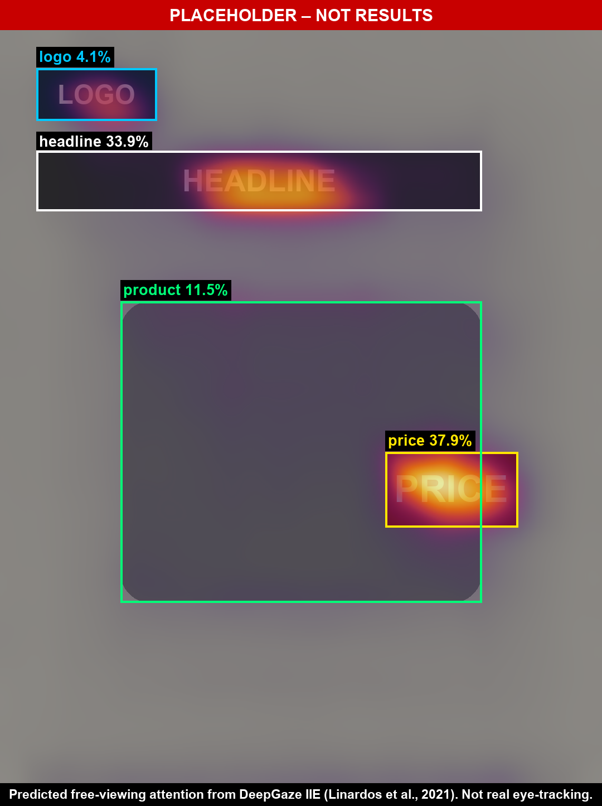
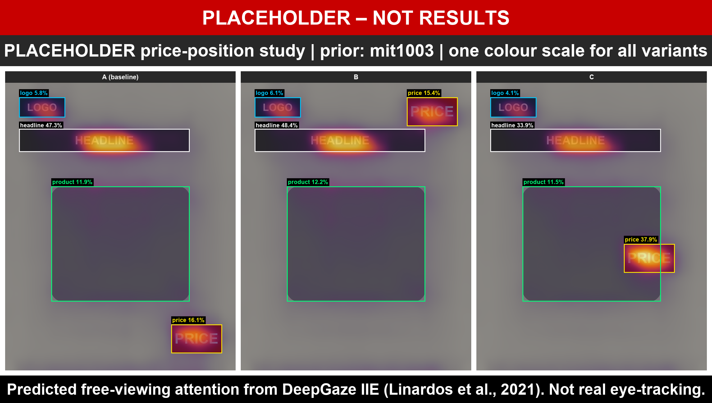
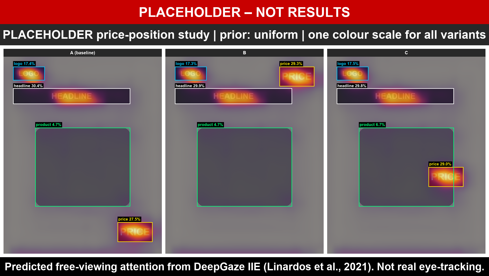

# Analysis guide: swapping in the real ads

> The pipeline produces **predicted** attention from DeepGaze IIE. It is not real eye-tracking.
> Say so wherever a number or heatmap from it is shown.

No code changes are needed. Everything below is files and one config.

> **Every picture and number in this guide comes from the placeholder study**
> (`examples/placeholder/`: grey boxes, not ads). They show what each step produces, nothing more.
> They are not results and must never be copied into the report.

Commands are given as `just` recipes (see the `justfile`; `brew install just`). The study folder is
an optional last argument and defaults to `data`, so `just run` means the real study. Without
`just`, replace `just <step>` with `.venv/bin/python -m src.glance_attention <step> --study data`.

## The whole flow



The model is first used in step 6. Everything before it fixes what will be measured, so that no
box can be adjusted after a heatmap has been seen.

| Step | Command | Needs | Produces |
|---|---|---|---|
| 1 | – | the design file | `data/images/<variant>.png` |
| 2 | – | – | `data/study.toml` edited |
| 3 | `just aoi-propose A`, `just aoi-apply A` (or by hand) | images | `data/aois/<variant>.json` |
| 4 | `just preview` | images, AOI files | `output/preview/<variant>_aois.png`, `aoi_boxes.csv` |
| 5 | `just validate` | images, AOI files | `data/aoi_lock.json` |
| 6 | `just run` | the lock | heatmaps, overlays, panels, per-variant tables, jitter tables, `run_log.json` |
| 7 | `just compare` | step 6 | `compare.csv`, `verdict.csv` |
| 8 | `just report` | steps 6 and 7 | `report.md`, `cross_tool_long.csv` |
| 9 | – | the commercial tools | the filled cross-tool table |

`just analyse` runs steps 6 to 8 in one go.

## 1. Put the images in `data/images/`

- One file per variant: `.png`, `.jpg`, `.jpeg` or `.webp`.
- The file name without extension is the variant's name in every table (`A.png` → `A`,
  `top_right.png` → `top_right`). Any number of variants from two upwards.
- All images must be exactly the same pixel size. Export them from the same design file, changing
  only the price layer's position.

**What it looks like.** The three placeholder variants: identical except for where the price sits.

| A (baseline) | B | C |
|:---:|:---:|:---:|
|  |  |  |

## 2. Edit `data/study.toml`

- `title`: shown on the report and the panels.
- `baseline`: the name of the conventional-placement variant.
- `placeholder = false`.
- `external_tools`: the commercial tools actually used and the metrics each will supply, with each
  tool's own scale. Rename `neurons_predict` to `expoze` here if that is the tool the group uses.
- Leave the threshold, jitter settings and seed alone unless the group decides otherwise, and record
  any change in [DECISIONS.md](DECISIONS.md) **before** running the model.

**What it looks like.** The lines most studies touch:

```toml
title = "Promo price position"
placeholder = false
baseline = "A"

[[external_tools]]
name = "attention_insight"
metrics = [
  { metric = "attention_pct", level = "aoi", scale = "0-100 % of attention" },
  { metric = "clarity_score", level = "image", scale = "0-100" },
]
```

## 3. Make the AOI files

An AOI (area of interest) is a named box on the image. Each variant gets one file,
`data/aois/<variant>.json`. Product, logo and headline must be identical in every file; only the
price box moves, and it keeps its size. Full instructions, including the AI-proposal route
(`just aoi-propose A`, then `just aoi-apply A`), are in [AOI_GENERATION.md](AOI_GENERATION.md).

**What it looks like.** `aois/A.json` for the placeholder; boxes are `[x0, y0, x1, y1]` in pixels:

```json
{
  "image": "A.png",
  "aois": {
    "price":    {"type": "price",    "boxes": [[778, 1134, 1016, 1269]]},
    "logo":     {"type": "logo",     "boxes": [[65, 68, 281, 162]]},
    "headline": {"type": "headline", "boxes": [[65, 216, 864, 324]]},
    "product":  {"type": "product",  "boxes": [[216, 486, 864, 1026]]}
  }
}
```

## 4. Preview the boxes

```bash
just preview
```

No model is involved. It draws the boxes from the AOI files on each image and writes
`data/output/preview/<variant>_aois.png`. Open every one and check each box by eye: does it enclose
the whole element and nothing else?

**What it produces.**

| A | C (price overlaps the product) |
|:---:|:---:|
|  |  |

It also writes `aoi_boxes.csv`: every box in pixels and as % of the image. Use the `_pct` columns to
draw the same AOIs inside the commercial tools, so that all three tools measure the same regions.

| variant | aoi | x0 | y0 | x1 | y1 | left_pct | top_pct | width_pct | height_pct |
|---|---|---|---|---|---|---|---|---|---|
| A | price | 778 | 1134 | 1016 | 1269 | 72.04 | 84.0 | 22.04 | 10.0 |
| A | product | 216 | 486 | 864 | 1026 | 20.0 | 36.0 | 60.0 | 40.0 |
| B | price | 778 | 68 | 1016 | 203 | 72.04 | 5.04 | 22.04 | 10.0 |

## 5. Validate and lock

```bash
just validate
```

It checks that image sizes match, every image has an AOI file, the fixed AOIs are identical in all
variants, the price box keeps its size, and boxes are inside the image. Fix every error it prints.

**What it prints** on success (placeholder study):

```text
WARNING validate_warning C: 'price' covers 23355 px of 'product'; those pixels count for 'price' only
INFO aois_locked variants=3 locked_utc=2026-11-21T19:59:47+00:00 file=examples/placeholder/aoi_lock.json
```

The warning is expected when the price sits on the product: the shared pixels are counted for the
price only (D4), so the shares still add up to 100%.

**What it produces.** `data/aoi_lock.json`: a fingerprint (SHA-256) and timestamp per AOI file.

```json
{
  "locked_utc": "2026-11-21T19:59:47+00:00",
  "files": {
    "A": {
      "file": "aois/A.json",
      "sha256": "4258e7e1d924781b2efd9273a31e4de4ea92416ed17860ffb84df38e05aad532",
      "modified_utc": "2026-11-21T19:59:47+00:00"
    }
  }
}
```

**Commit the images, AOI files and lock now, before the next step.** That commit is the evidence
that the AOIs were fixed before any heatmap existed. `run` refuses to start if an AOI file no longer
matches the lock.

## 6. Run the model

```bash
just run
```

About half a minute for three images on a laptop CPU (the first ever run also downloads the model
weights). Commit your work first, so the run log does not say "uncommitted changes". Everything is
computed twice: with the standard centre bias (`mit1003`, the primary result) and with none
(`uniform`, the sensitivity check).

**What it produces**, all under `data/output/`:

**a) A heatmap per variant** (`heatmaps/<variant>_heatmap.png`): the image with predicted attention
laid over it. Brighter means more predicted attention.

**b) An AOI overlay per variant** (`heatmaps/<variant>_aoi.png`): the same heatmap with the locked
boxes and each AOI's share of predicted attention.

| Heatmap (C) | AOI overlay (C) |
|:---:|:---:|
|  |  |

**c) A side-by-side panel** (`panel.png`): all variants on one colour scale, so brightness can be
compared between them. This is the figure most likely to go in the report.



**d) The same panel with no centre bias** (`panel_no_centerbias.png`). If a variant only looks
better in the first panel, its advantage may come from the price being nearer the centre.



**e) A table per variant** (`<variant>_aoi.csv`). Placeholder A, primary setting:

| aoi | share_pct | area_pct | density | peak | share_rank | first_look_rank |
|---|---|---|---|---|---|---|
| price | 16.13 | 2.20 | 7.32 | 17.26 | 2 | 2 |
| logo | 5.84 | 1.39 | 4.19 | 8.56 | 4 | 3 |
| headline | 47.31 | 5.92 | 7.99 | 28.12 | 1 | 1 |
| product | 11.87 | 24.00 | 0.49 | 1.98 | 3 | 4 |
| rest | 18.86 | 66.49 | 0.28 | 13.17 | | |

| Column | Meaning |
|---|---|
| `share_pct` | % of all predicted attention that falls in the AOI. The column sums to 100 |
| `area_pct` | % of the image the AOI covers |
| `density` | `share_pct` ÷ `area_pct`. 1 means attention in proportion to size; above 1, more than its size alone would give |
| `peak` | The strongest single point inside the AOI |
| `share_rank` | Order by share (1 = most) |
| `first_look_rank` | Order by peak: a rough guess at what draws the eye first. It is not a scanpath |

**f) One row per variant of image-level numbers** (`summary.csv`):

| variant | entropy_norm | clarity | top10_pct | first_look_order |
|---|---|---|---|---|
| A | 0.806 | 0.194 | 78.3 | headline > price > logo > product |
| B | 0.803 | 0.197 | 78.9 | headline > price > logo > product |
| C | 0.781 | 0.219 | 84.1 | price > headline > product > logo |

`entropy_norm` is how spread out the attention is (0 = one point, 1 = even everywhere); `clarity`
is 1 minus that; `top10_pct` is the share of attention inside the hottest 10% of the image.

**g) Robustness tables** (`jitter.csv`, `jitter_stability.csv`). Every box edge is nudged by up to
±5%, 200 times, to see whether the result depends on exactly where a box was drawn.
`jitter_stability.csv` says how often the conclusion stayed the same:

| centerbias | check | unchanged_pct |
|---|---|---|
| mit1003 | price_share_order | 100.0 |
| mit1003 | product_drop_flag:C | 97.5 |
| uniform | price_share_order | 98.5 |

**h) The run log** (`run_log.json`): model and its commit, centre-bias settings, file fingerprints
of the weights, images and AOIs, library versions, date, and the git commit of the code. This is
the reproducibility record for the appendix.

## 7. Compare against the baseline

```bash
just compare
```

**What it produces.**

`verdict.csv`: the key test, one row per non-baseline variant and centre-bias setting.
Placeholder values:

| variant | centerbias | price_share_pct | price_delta_pp | is_price_up | product_delta_rel_pct | is_product_held | verdict |
|---|---|---|---|---|---|---|---|
| B | mit1003 | 15.41 | −0.72 | False | +2.84 | True | price share not up; product held |
| B | uniform | 29.34 | +1.83 | True | −1.65 | True | price share up; product held |
| C | mit1003 | 37.89 | +21.76 | True | −3.04 | True | price share up; product held |
| C | uniform | 28.97 | +1.46 | True | +42.13 | True | price share up; product held |

- `price_delta_pp`: change in the price's share against the baseline, in percentage points.
- `product_delta_rel_pct`: change in the product's share as a % of the baseline's product share.
  The product is "held" unless this falls below −10% (`product_drop_threshold_pct`).
- Compare the `mit1003` and `uniform` rows of one variant. Here C's large gain (+21.76) shrinks to
  +1.46 without the centre bias: most of it came from the price being nearer the middle.

`compare.csv`: the full detail behind it, one row per variant, AOI and metric, with
`baseline_value`, `variant_value`, `delta` and `delta_rel_pct`.

## 8. Write the report

```bash
just report
```

Then commit `data/output/`.

**What it produces.**

`report.md`: everything above in one readable file. Sections: Run, Attention share per AOI, Key
test against the baseline, Per-variant AOI tables, Sensitivity: no centre bias, Robustness: jittered
AOI boxes, Reading notes. See the placeholder one:
[PLACEHOLDER_report.md](../examples/placeholder/output/PLACEHOLDER_report.md).

`cross_tool_long.csv`: the shared table for all three tools, one value per row. The DeepGaze rows
are filled; each other tool gets empty rows to type into.

| tool | variant | aoi | metric | value | scale | run_date | version |
|---|---|---|---|---|---|---|---|
| deepgaze_iie | A | price | attention_pct | 16.1288 | 0-100 % of predicted attention | 2026-11-21 | deepgaze@c7db17e pipeline@0.1.0 |
| deepgaze_iie | A | price | attention_density | 7.3189 | attention % per area %; 1 = proportional to size | 2026-11-21 | deepgaze@c7db17e pipeline@0.1.0 |
| attention_insight | A | price | attention_pct | | 0-100 % of attention | | |
| attention_insight | A | logo | attention_pct | | 0-100 % of attention | | |

(In the placeholder file every `version` starts with `PLACEHOLDER`.) Metrics ending in
`_no_centerbias` are the sensitivity values.

## 9. Fill in the other tools

Open `data/output/cross_tool_long.csv`. For each empty row, type the value from the commercial tool
into `value`, the export date into `run_date` and the tool's version into `version`. Do not change
the DeepGaze rows. Keep a copy of the filled table outside `output/`, because `report` rewrites the
file.

## 10. Read the results

1. `report.md`, "Key test": for each variant, is the price share up and is the product held?
2. "Sensitivity: no centre bias": does the same variant still win? If not, its advantage may come
   from being central.
3. "Robustness": do the ordering and the flags survive the jittered boxes?
4. Across tools, compare directions and rankings, never raw values: the scales differ.

## Where everything ends up

```text
data/
  study.toml                      step 2
  images/<variant>.png            step 1
  aois/<variant>.json             step 3
  aoi_lock.json                   step 5
  output/
    preview/<variant>_aois.png    step 4
    preview/aoi_boxes.csv         step 4
    heatmaps/<variant>_heatmap.png   step 6
    heatmaps/<variant>_aoi.png       step 6
    panel.png, panel_no_centerbias.png   step 6
    <variant>_aoi.csv, summary.csv       step 6
    jitter.csv, jitter_stability.csv     step 6
    run_log.json                  step 6
    compare.csv, verdict.csv      step 7
    report.md, cross_tool_long.csv   step 8
    density/                      step 6 (raw model output; not committed)
```

In the placeholder study every output file name starts with `PLACEHOLDER_`.

## Rules

- Never change an AOI file after looking at a heatmap. If a box is truly wrong, fix it, re-validate,
  rerun, and explain it in [DECISIONS.md](DECISIONS.md); the run log will show the change.
- Never copy anything from `examples/placeholder/` into the report.
- No personal names or local file paths in the repository, including in the git identity used for
  commits.
- Disclose every AI-assisted step in [AI_USE_AND_PROMPTS.md](AI_USE_AND_PROMPTS.md) with its exact
  prompt.
