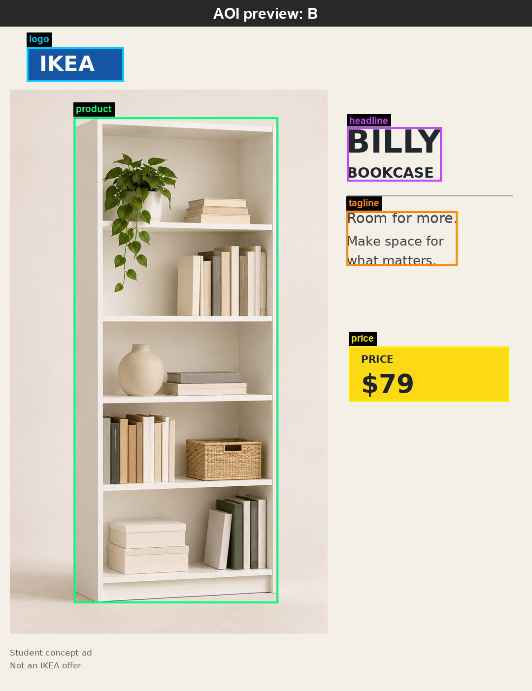

# 2. Areas of interest (AOIs)

[Back to the overview](../README.md)

An area of interest is a rectangle around one element of the ad. A tool's "attention %" for an area
is the part of its predicted attention that falls inside that rectangle.

| Area | What it covers | Box `[left, top, right, bottom]` in px |
|---|---|---|
| price | the yellow tag | A: 708, 50, 1033, 161 · B: 708, 650, 1033, 761 · C: 708, 1010, 1033, 1121 |
| product | the bookcase itself, not the photo around it | 149, 184, 564, 1171 |
| logo | the blue logo panel | 54, 42, 251, 111 |
| headline | "BILLY BOOKCASE" | 704, 204, 896, 314 |
| tagline | "Room for more. Make space for what matters." | 703, 375, 928, 486 |

Product, logo, headline and tagline are the same box in every version. Only the price box moves,
and it keeps its size. Everything outside the five boxes (photo background, empty space, small
print) is counted as `rest`.

## Files

| File | Contents |
|---|---|
| `A.json`, `B.json`, `C.json` | the boxes for each version |
| `aoi_boxes.csv` | the same boxes in pixels and in % of the image |
| `previews/` | each version with its boxes drawn on, for checking by eye |
| `aoi_lock.json` | the record that the boxes were fixed before the model ran |

## How the boxes were made

1. An AI model proposed price, product, logo and headline from the clean image.
2. A person checked them. The tagline box was added by hand, measured from the text's pixels.
3. They were locked before any heatmap existed, so they could not be moved to suit a result.

Two choices worth knowing:

- **The product box is tight on the bookcase.** A box around the whole photo would be half the ad
  and mostly empty wall, and would mostly measure "the middle of the image".
- **Headline and tagline are separate boxes.** The tag sits next to the headline in A and nearer the
  tagline in B, so separate boxes show which one it competes with.

## In the commercial tools

The same boxes were drawn by mouse in Attention Insight and Brainsight. Read back from each tool's
page, every edge is within 2 px of the locked box. DeepGaze's robustness check moves edges by far
more than that (see [3_deepgaze](../3_deepgaze/README.md#robustness-check)).
