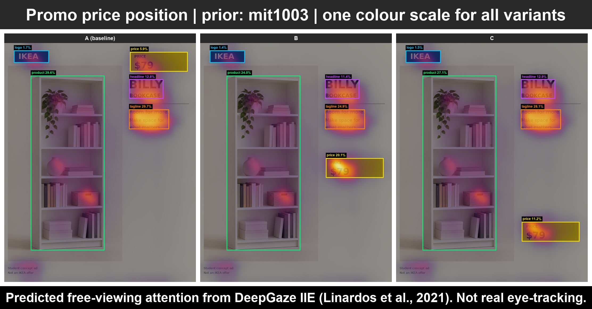
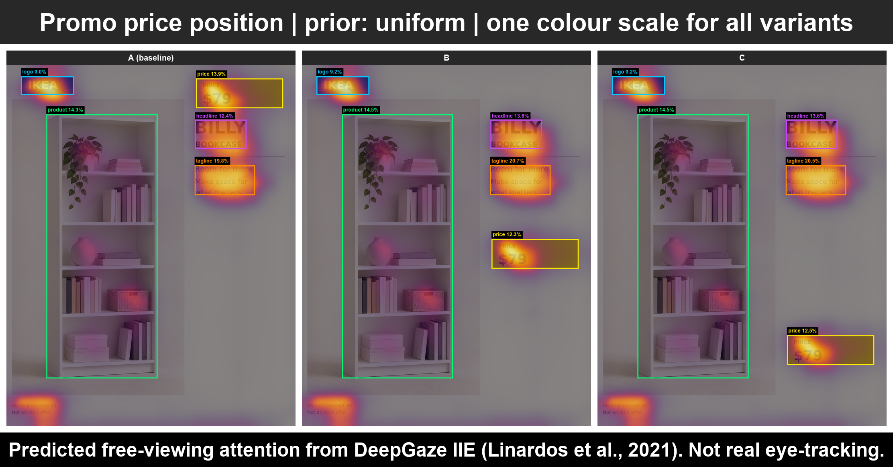

# 3. DeepGaze IIE

[Back to the overview](../README.md)

> Predicted free-viewing attention from DeepGaze IIE (Linardos et al., 2021). Not real eye-tracking.

DeepGaze IIE is an open-source research model. It looks at an image and estimates, for every pixel,
how likely a viewer is to look there. We ran it on our own computer, so every number here can be
reproduced. It is the most detailed of the three tools: exact values, two settings, and a
robustness check.

## Results

Share of predicted attention per area, in %.

| Area | A | B | C |
|---|---|---|---|
| price | 5.9 | 20.1 | 11.2 |
| product | 29.6 | 24.0 | 27.1 |
| headline | 12.8 | 11.4 | 12.9 |
| tagline | 29.7 | 24.9 | 28.1 |
| logo | 1.7 | 1.4 | 1.5 |
| rest | 20.4 | 18.3 | 19.1 |

## The key test

The rule was fixed before the model ran: a version passes if the price share goes up **and** the
product share does not fall by more than 10% of its baseline value.

| Version | Price change | Product change (% of baseline) | Verdict |
|---|---|---|---|
| B | +14.2 points | −18.8% | price up; **product drop flagged** |
| C | +5.4 points | −8.3% | price up; product held |

C passes, but −8.3% is close to the −10% line.

## The centre bias, explained

The results above use the model's standard setting, "with centre bias". We also ran it without.
The difference matters for reading our result.

**People look at the middle.** Show people almost any picture and they look at the centre more than
the edges, whatever is in it. Photographers put the subject in the middle, and eyes tend to start
from the middle of a screen. This is the centre bias.

**DeepGaze builds it in as a "prior".** The model works in two parts:

1. It looks at the image and works out which parts are eye-catching (contrast, text, objects).
2. It combines that with a prior: a map of where people tend to look before the content is even
   considered.

**MIT1003 is where the prior comes from.** It is a public eye-tracking dataset: 1003 images, each
viewed freely for three seconds by 15 people (Judd et al., 2009). Average where all of them looked,
over all the images, and you get a soft blob that is densest in the middle and fades to the edges.
That averaged map is the "MIT1003 centre bias". In the files it is called `mit1003`.

**"No centre bias" means a flat prior.** Every position is treated as equally likely, so only part 1
is left: how eye-catching the content is. In the files it is called `uniform`.

| | With centre bias (`mit1003`) | No centre bias (`uniform`) |
|---|---|---|
| What it reflects | image content plus the pull of the middle | image content only |
| Closer to | how people view images in general | an abstract check |
| Our use | the main result | the sensitivity check |

**Why we report both.** Our experiment moves the price tag to different positions. With the centre
bias, a tag nearer the middle gains attention just for being there. Without it, we see whether the
tag itself stands out any more. Neither is "the right one": the first is the more realistic
prediction, the second shows how much of the result rests on the pull of the middle.

### What it shows here

| Area | Setting | A | B | C |
|---|---|---|---|---|
| price | with centre bias | 5.9 | 20.1 | 11.2 |
| price | no centre bias | 13.9 | 12.3 | 12.5 |
| product | with centre bias | 29.6 | 24.0 | 27.1 |
| product | no centre bias | 14.3 | 14.5 | 14.5 |

Without the centre bias the tag gets about the same share in every version, and the product does
not move. So the tag is equally eye-catching wherever it sits. B's and C's advantage comes from
sitting nearer the middle than A's top corner, and B's cost to the product comes from the same
place.

## Robustness check

Would the conclusions change if a box had been drawn a little differently? Every box edge was moved
at random by up to 5% of the box's size, 200 times.

- The order of the versions by price share stayed the same in all 200 redraws.
- The product flag for B and the pass for C stayed the same in all 200 redraws.

## Other terms in the tables

| Term | Meaning |
|---|---|
| `share_pct` | attention %, as in the tables above |
| `area_pct` | the box's size as % of the image |
| `density` | share ÷ area. Above 1 means the area draws more attention than its size alone would |
| `first_look_rank` | areas ranked by their single brightest point. What stands out first, not a real viewing sequence |
| `clarity` | 0–1, higher means attention is more concentrated. It barely differs between versions of one ad |

## How to look at the pictures

- **`heatmaps/A_heatmap.png`** (and B, C): the ad dimmed, with predicted attention laid over it.
  Yellow is the most, then orange and purple; grey means little or none.
- **`heatmaps/A_aoi.png`**: the same picture with the five boxes drawn on and each box's share
  written above it.
- **`panel.png`**: all three versions on one colour scale, so the same colour means the same amount
  of attention in each. Use this to compare versions by eye.
- **`panel_no_centerbias.png`**: the same without the centre bias.

The boxes and labels are drawn on afterwards. The model only ever saw the clean ad.

## Files

| File | Contents |
|---|---|
| `report.md` | the full written report from the pipeline |
| `panel.png`, `panel_no_centerbias.png` | the three versions side by side, one colour scale |
| `heatmaps/` | per version: the heatmap alone, and with boxes and shares |
| `tables/A_aoi.csv`, `B_aoi.csv`, `C_aoi.csv` | every metric for every area, under both settings |
| `tables/summary.csv` | whole-image scores and first-look order |
| `tables/compare.csv` | every metric in B and C against A |
| `tables/verdict.csv` | the key test |
| `tables/jitter.csv`, `jitter_stability.csv` | the robustness check |
| `run_log.json` | model version, date and settings of the run |

## References

- Linardos, A., Kümmerer, M., Press, O. and Bethge, M. (2021) 'DeepGaze IIE: Calibrated prediction
  in and out-of-domain for state-of-the-art saliency modeling', *ICCV 2021*.
- Judd, T., Ehinger, K., Durand, F. and Torralba, A. (2009) 'Learning to predict where humans look',
  *IEEE 12th International Conference on Computer Vision*, pp. 2106-2113.
