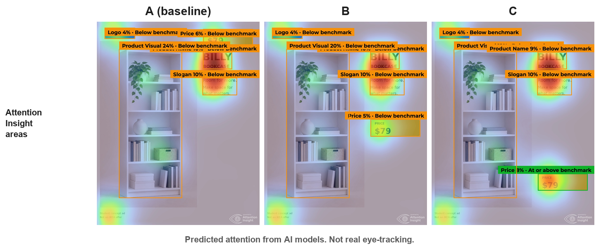

# 4. Attention Insight

[Back to the overview](../README.md)

> Predicted attention from a commercial AI tool. Not real eye-tracking.

A commercial web tool. We uploaded the three clean images and drew the same five boxes as in
[2_aois](../2_aois/README.md).

**Settings:** asset type Advertising, channel Social Ads, objective Product Highlight.

## Results

Attention per area, in %. The tool reports whole percentages only.

| Area (our name) | Name in the tool | A | B | C |
|---|---|---|---|---|
| price | Price | 6 | 5 | 8 |
| product | Product Visual | 24 | 20 | 19 |
| headline | Product Name | 10 | 10 | 9 |
| tagline | Slogan | 10 | 10 | 10 |
| logo | Logo | 4 | 4 | 4 |

Its overall "Visual Performance Score" was 69 out of 100 for all three versions, so that score does
not separate them.

## How to read it

- **Price:** up 2 points in C. Down 1 point in B, which is too small to tell apart from rounding.
- **Product:** down in both B (−4) and C (−5). This is the one tool where C costs the product more
  than B does.
- **Headline, tagline, logo:** unchanged.

## Things to know

- **B and C were run twice.** The tool copied A's boxes onto B and C, so their first analyses had
  the price box in A's position. Both were redrawn and re-run. The exports here are from the
  corrected runs, which the tool calls "B redraw" and "C redraw".
- **The percentages are not simple slices of one total.** For A the five areas add up to 54%, while
  the tool's own summary says 41% of attention lands on the marked areas. We do not know exactly
  how its area values are calculated.
- **"Benchmark" labels in the screenshots** compare each area with the tool's own typical values
  for social ads. We do not use them.
- The tool does not say whether it uses a centre bias, and offers no way to switch one off
  (compare [3_deepgaze](../3_deepgaze/README.md#the-centre-bias-explained)).

## The files and how to look at them

Each of `A/`, `B/` and `C/` holds the same set. Start with `aoi.jpg`, then `aoi_data.csv`.

| File | What it shows | How to read it |
|---|---|---|
| `aoi.jpg` | the heatmap with our five boxes and the tool's percentage for each | The quickest overview. The orange labels say "Below benchmark": ignore that part, it compares with the tool's own typical ads |
| `heatmap.jpg` | the heatmap on its own | Red is the most predicted attention, then yellow, green, blue; grey-purple is little or none |
| `saliency.jpg` | the same prediction as a black-and-white map | White is high, black is none. This is the raw picture the heatmap is coloured from |
| `focus.jpg` | the ad with everything outside the attention areas darkened | What stays bright is what the tool expects a viewer to take in at a first glance |
| `contrast.jpg` | a grid of text-contrast checks laid over the ad | Green cells pass the tool's readability check, orange and red do not. It is about legibility, not attention, and we do not use it |
| `original.jpg` | the image as the tool stored it | For checking it is the same ad |
| `aoi_data.csv` | the numbers | See the columns below |
| `validation_report.pdf` | the tool's own multi-page report | Its scores, the pictures above and its design advice. The advice is generated by the tool and is not part of our analysis |

Columns of `aoi_data.csv`:

| Column | Meaning |
|---|---|
| `Text` | the area's name in the tool |
| `Value` | predicted attention as a fraction: 0.08 means 8% |
| `Benchmark Name`, `Benchmark Description`, `Benchmark Indicator` | the tool's comparison with its own typical values; not used |
| `X`, `Y` | the box's left and top edge, in % of the image |
| `Width`, `Height` | the box's size, in % of the image |
| `Size` | the box's area, in % of the image |

`screenshots/` holds the tool's screens as proof of use: the result pages for A, B and C, and the
box-drawing step for B and C.

### What to notice in the pictures

- In A the red area runs from the price tag down through the headline: the tag is inside the main
  hot spot.
- In B the tag is only faintly coloured; in C it has a clear spot of its own. That matches the
  numbers (5% and 8%).
- The bottom-left corner lights up in every version. That is the small print, which is outside all
  five boxes.
