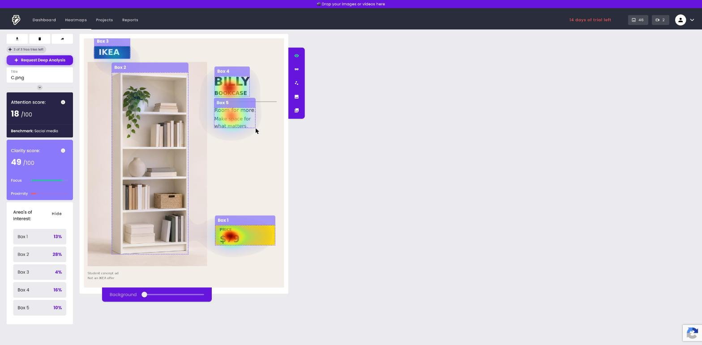
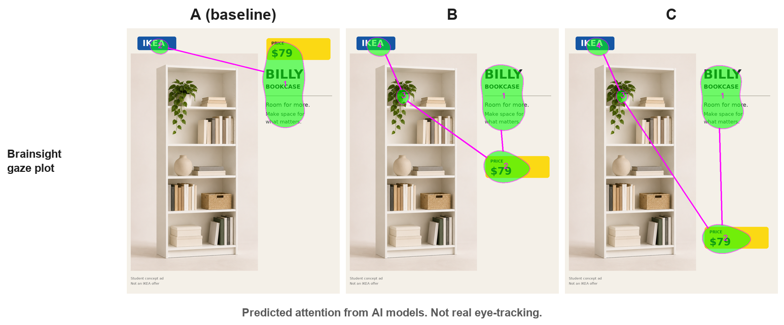

# 5. Brainsight

[Back to the overview](../README.md)

> Predicted attention from a commercial AI tool. Not real eye-tracking.

A commercial web tool. We uploaded the three clean images and drew the same five boxes as in
[2_aois](../2_aois/README.md).

**Settings:** type Social media.

## Results

Attention per area, in %. The tool shows whole percentages only.

| Area | Box in the tool | A | B | C |
|---|---|---|---|---|
| price | Box 1 | 10 | 12 | 13 |
| product | Box 2 | 28 | 27 | 28 |
| logo | Box 3 | 4 | 4 | 4 |
| headline | Box 4 | 20 | 17 | 16 |
| tagline | Box 5 | 9 | 10 | 10 |

The tool's own scores for the whole ad, each out of 100:

| Version | Attention score | Clarity score |
|---|---|---|
| A | 17 | 56 |
| B | 20 | 66 |
| C | 18 | 49 |

## Predicted viewing order

Brainsight also draws a "gaze plot": the areas it expects to hold a viewer's eye, numbered in the
order it expects them to be visited.

| Version | Stop 1 | Stop 2 | Stop 3 | Stop 4 |
|---|---|---|---|---|
| A | text block, with the price tag inside it | logo | – | – |
| B | text block | **price tag** | plant on the top shelf | logo |
| C | text block | **price tag** | plant on the top shelf | logo |

In A the tag does not get a stop of its own: it is swallowed by the text block next to it. In B and
C it becomes the second stop. This is the tool's prediction of an order, not a recording of one.

## How to read it

- **Price:** up in both B (+2) and C (+3).
- **Product:** unchanged, within a point.
- **Headline:** down in B (−3) and C (−4). In A the tag sits right above the headline, so some of
  the attention around the tag falls into the headline box; once the tag moves away, it does not.
- **Scores:** the tool does not publish how they are calculated, and they are not comparable with
  DeepGaze's clarity or Attention Insight's score.

## Things to know

- **The numbers were typed by hand from the screenshots.** The tool has no data export for areas.
  `aoi_values.csv` and `image_scores.csv` hold the typed values, and each row names the screenshot
  it was read from.
- The tool numbers boxes in the order they were drawn, which is the order in the table above.
- The tool does not say whether it uses a centre bias, and offers no way to switch one off
  (compare [3_deepgaze](../3_deepgaze/README.md#the-centre-bias-explained)).

## The files and how to look at them

Start with the screenshots, which show the boxes and percentages together, then the heatmaps.

| File | What it shows | How to read it |
|---|---|---|
| `screenshots/A_result_aois.jpg` (and B, C) | the tool's result screen with our five boxes and their percentages | The source of every Brainsight number here. Scores are on the left, boxes on the image |
| `aoi_values.csv` | attention % per area and version | Typed from the screenshots; the `source` column names which one |
| `image_scores.csv` | the attention and clarity scores per version | Typed from the screenshots |
| `A/heatmap.png` (and B, C) | the heatmap on the ad | Red is the most predicted attention, fading through yellow and green to blue; no colour means little or none |
| `A/gazeplot.png` | the predicted viewing order | Green shapes are the stops, the numbers are the order, the lines join them |
| `A/peekthrough.png` | the ad with everything hidden except the attention areas | What shows through is what the tool expects to be noticed; the purple is just a mask |
| `A/template_heatmap.png`, `template_original.png` | the ad placed in a mock social-media feed, with and without the heatmap | A sense of the ad in context. The surrounding post is the tool's stock example, not ours, and no numbers come from it |
| `gazeplots_ABC.png` | the three gaze plots side by side | Made by us from the three `gazeplot.png` files |

### What to notice in the pictures

- The strongest spot in every version is on the product name.
- In A the price tag is only lightly coloured and merges with the name above it. In B and C the tag
  has a strong spot of its own, on the "$79".
- The bookcase has almost no colour in any version, yet its box reads 27–28%. The box is large, so
  a thin spread over it still adds up.
