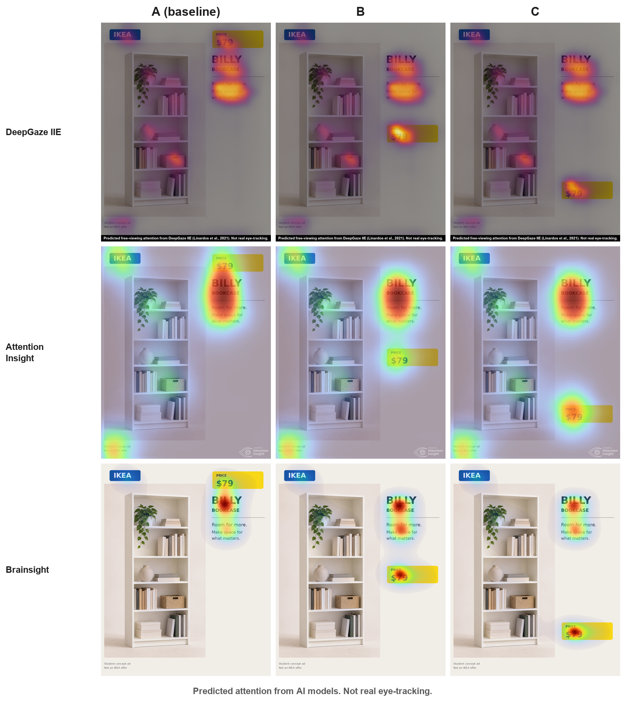

# 6. All tools side by side

[Back to the overview](../README.md)

> Every value is predicted attention from an AI model. None of it is real eye-tracking.

## All areas, all tools

Attention %, with the change from A in percentage points.

| Tool | Area | A | B | C | B − A | C − A |
|---|---|---|---|---|---|---|
| DeepGaze IIE | price | 5.9 | 20.1 | 11.2 | +14.2 | +5.4 |
| DeepGaze IIE | product | 29.6 | 24.0 | 27.1 | −5.6 | −2.5 |
| DeepGaze IIE | headline | 12.8 | 11.4 | 12.9 | −1.4 | +0.1 |
| DeepGaze IIE | tagline | 29.7 | 24.9 | 28.1 | −4.9 | −1.7 |
| DeepGaze IIE | logo | 1.7 | 1.4 | 1.5 | −0.3 | −0.1 |
| Attention Insight | price | 6 | 5 | 8 | −1 | +2 |
| Attention Insight | product | 24 | 20 | 19 | −4 | −5 |
| Attention Insight | headline | 10 | 10 | 9 | 0 | −1 |
| Attention Insight | tagline | 10 | 10 | 10 | 0 | 0 |
| Attention Insight | logo | 4 | 4 | 4 | 0 | 0 |
| Brainsight | price | 10 | 12 | 13 | +2 | +3 |
| Brainsight | product | 28 | 27 | 28 | −1 | 0 |
| Brainsight | headline | 20 | 17 | 16 | −3 | −4 |
| Brainsight | tagline | 9 | 10 | 10 | +1 | +1 |
| Brainsight | logo | 4 | 4 | 4 | 0 | 0 |

DeepGaze values are with its centre bias; the set without it is in
[3_deepgaze](../3_deepgaze/README.md#what-it-shows-here).

## The heatmaps side by side

Each tool colours attention its own way, so compare along a row. In every tool the text block is
the hot spot, and the price tag gets a spot of its own only once it moves away from that block.

## Do the tools agree?

| Question | DeepGaze IIE | Attention Insight | Brainsight |
|---|---|---|---|
| Price up in B? | yes, strongly | no | yes |
| Price up in C? | yes | yes | yes |
| Product held in B? | **no** (−18.8% of baseline) | no (24 → 20) | yes |
| Product held in C? | yes (−8.3% of baseline) | no (24 → 19) | yes |

## What it means

1. **C is the consistent one.** It is the only version where all three tools show the price gaining.
2. **B's gain is the largest but the least reliable.** It is flagged in DeepGaze for taking
   attention from the product, and Attention Insight shows no gain.
3. **In DeepGaze, position works through the centre.** Without the model's centre bias, neither B
   nor C beats A. The tag is not more eye-catching lower down; it is nearer where the model expects
   eyes to go. See [the explanation](../3_deepgaze/README.md#the-centre-bias-explained).
4. **The product result is not agreed.** Brainsight shows no cost, Attention Insight shows a cost in
   both versions, DeepGaze only in B.
5. **Small differences in the commercial tools are weak evidence.** They report whole percentages,
   so 1 point cannot be told apart from rounding and 2–3 points are only just readable.

A fair one-sentence summary for the report: moving the price tag lower or more central raised its
predicted attention in most of the model runs, most consistently for the bottom-right position,
but the size of the effect depends on each model's assumptions and the models disagree on whether
the product loses attention.

## Why raw values cannot be compared across tools

Each tool turns its heatmap into percentages its own way. DeepGaze's shares add up to 100% with
`rest`; Attention Insight's do not behave like slices of one total; Brainsight does not say. So read
each row left to right (A against B against C), and compare only the direction between rows.

## Files

| File | Contents |
|---|---|
| `heatmaps_by_tool.png` | the picture above, made by us from each tool's heatmaps |
| `attention_pct_by_tool.csv` | the table above, with DeepGaze under both settings and its `rest` |
| `cross_tool_long.csv` | every metric from every tool, one value per row |

Columns of `cross_tool_long.csv`:

| Column | Meaning |
|---|---|
| `tool` | `deepgaze_iie`, `attention_insight` or `brainsight` |
| `variant` | A, B or C |
| `aoi` | the area, or `(image)` for a whole-ad score |
| `metric` | what is measured; names ending `_no_centerbias` are DeepGaze without its centre bias |
| `value` | the number; empty where a tool does not report it (`rest` in the commercial tools) |
| `scale` | the unit and range of that metric |
| `run_date`, `version` | when it was collected and from which version |
