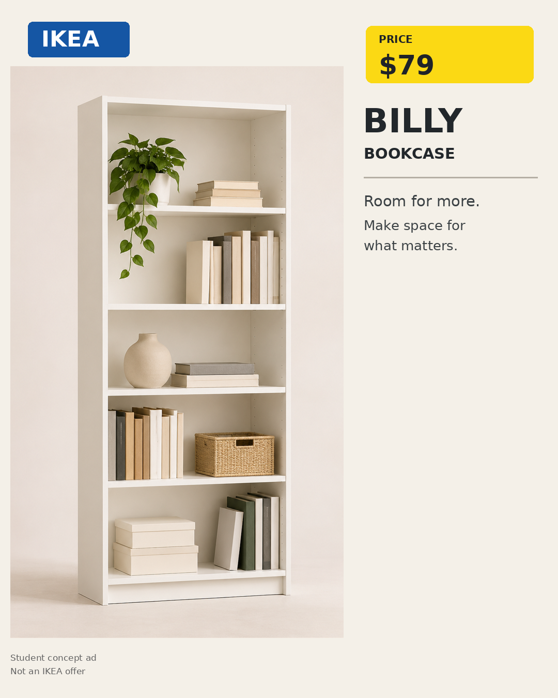
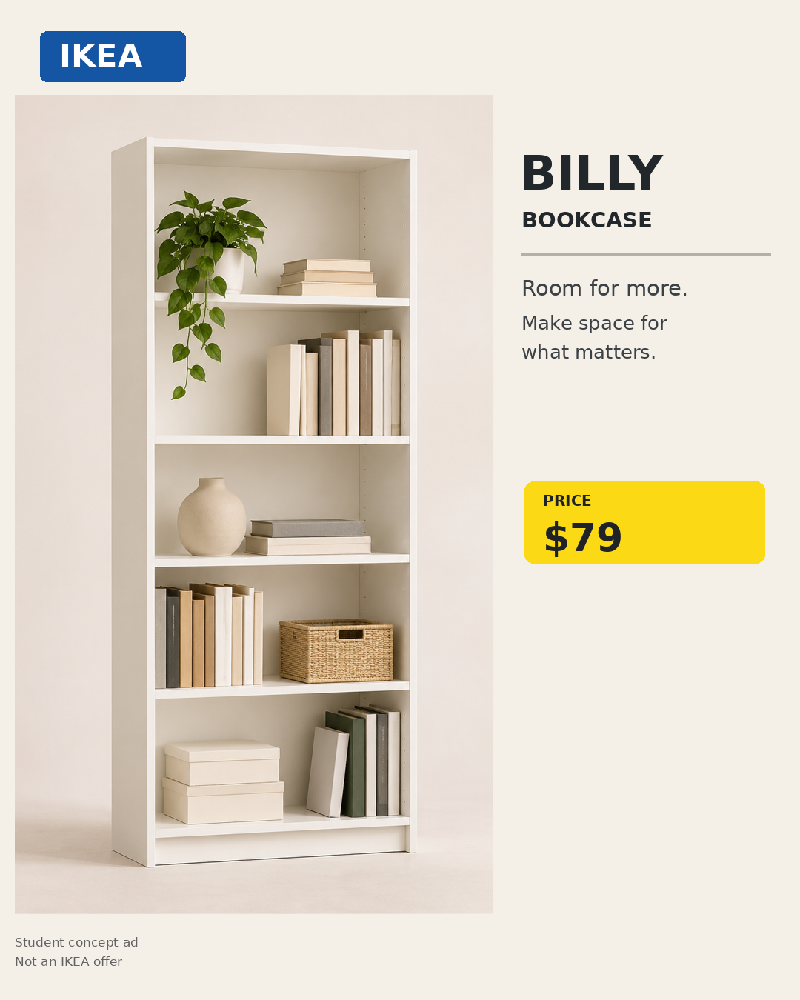
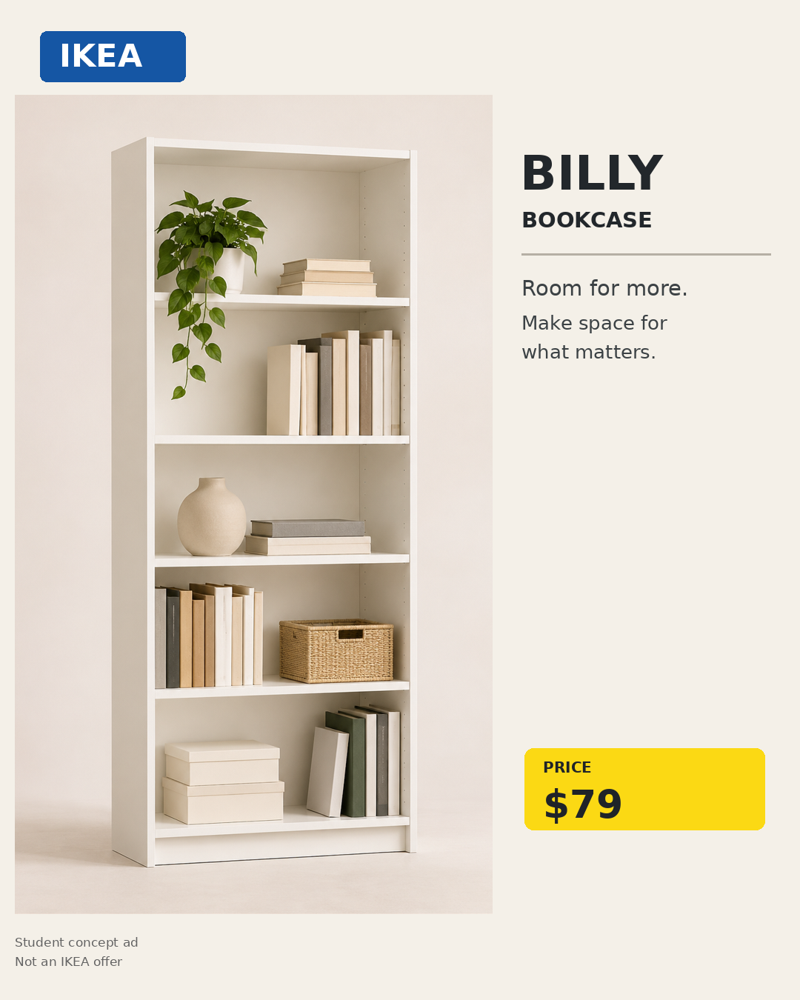
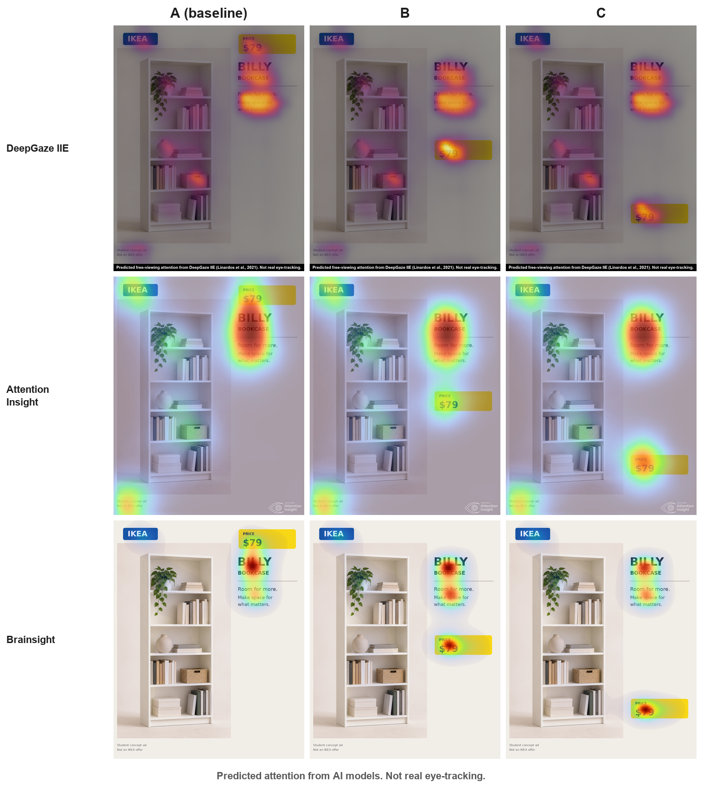

# Promo price position: results from three attention models

Collected on 2026-11-23. Ad versions, areas of interest, raw exports from each tool, processed
tables, and a reading of what they say.

> **Everything here is predicted attention from AI models. None of it is real eye-tracking.**

## The question

One ad for a bookcase, three versions. Only the position of the yellow price tag changes: top right
(A, the baseline), middle right (B) or bottom right (C).

**Does moving the price tag win it more predicted attention, without taking attention away from
the product?**

| A (baseline) | B | C |
|---|---|---|
|  |  |  |

## The short answer

- **C is the only version where the price gains attention in all three tools.**
- **B gains the most in DeepGaze but fails our test**: it takes too much attention from the product.
- **In DeepGaze the gain comes from the tag sitting nearer the middle of the ad**, not from the tag
  becoming more eye-catching. [Why that matters](3_deepgaze/README.md#the-centre-bias-explained).
- **The tools disagree on whether the product loses attention**: Brainsight says no, Attention
  Insight says yes in both, DeepGaze only in B.

The evidence leans towards C, and it is not strong.

## Results

Share of predicted attention, in %. "B − A" and "C − A" are changes from the baseline in
percentage points.

**Price tag**

| Tool | A | B | C | B − A | C − A |
|---|---|---|---|---|---|
| DeepGaze IIE | 5.9 | 20.1 | 11.2 | +14.2 | +5.4 |
| Attention Insight | 6 | 5 | 8 | −1 | +2 |
| Brainsight | 10 | 12 | 13 | +2 | +3 |

**Product (the bookcase)**

| Tool | A | B | C | B − A | C − A |
|---|---|---|---|---|---|
| DeepGaze IIE | 29.6 | 24.0 | 27.1 | −5.6 | −2.5 |
| Attention Insight | 24 | 20 | 19 | −4 | −5 |
| Brainsight | 28 | 27 | 28 | −1 | 0 |

All areas and all tools side by side: [6_all_tools](6_all_tools/README.md).

## What each tool shows

Each row is one tool, each column one version. Warmer colour means more predicted attention. The
colour scales differ between tools, so compare along a row, not down a column.



What the three have in common:

- **The text block is the hot spot in every tool.** The product name and tagline draw the strongest
  predicted attention in all nine pictures; the bookcase gets a thinner spread.
- **In A the price tag sits inside that hot spot.** It is hard to tell the tag's own attention from
  the headline's. In B and C the tag gets a spot of its own.

Where they differ:

| Tool | What it shows | Its guide |
|---|---|---|
| **DeepGaze IIE** | The largest effect: price 5.9% → 20.1% (B) and 11.2% (C). B takes attention from the product. The effect depends on the model's centre bias. | [3_deepgaze](3_deepgaze/README.md) |
| **Attention Insight** | The smallest effect: price 6% → 5% (B) and 8% (C). The product share falls in both B and C. One overall score, 69, for all three. | [4_attention_insight](4_attention_insight/README.md) |
| **Brainsight** | A steady gain: price 10% → 12% (B) and 13% (C), with the product unchanged. Its predicted viewing order puts the price second in B and C; in A the tag has no stop of its own. | [5_brainsight](5_brainsight/README.md) |

| Question | DeepGaze IIE | Attention Insight | Brainsight |
|---|---|---|---|
| Price up in B? | yes, strongly | no | yes |
| Price up in C? | yes | yes | yes |
| Product held in B? | **no** | no | yes |
| Product held in C? | yes | no | yes |

The full comparison and what it means: [6_all_tools](6_all_tools/README.md#what-it-means).

## Where to find what

| Folder | What is in it | Read its guide for |
|---|---|---|
| [1_ads](1_ads/README.md) | the three ad versions | what differs between them |
| [2_aois](2_aois/README.md) | the five areas of interest | what each box covers and how they were fixed |
| [3_deepgaze](3_deepgaze/README.md) | DeepGaze IIE tables, heatmaps, report | the key test, the centre bias, the robustness check |
| [4_attention_insight](4_attention_insight/README.md) | Attention Insight exports and screenshots | its settings, numbers and quirks |
| [5_brainsight](5_brainsight/README.md) | Brainsight exports and screenshots | its settings, numbers and scores |
| [6_all_tools](6_all_tools/README.md) | every tool in one table | comparing tools and the overall reading |

```text
1_ads  →  2_aois  →  3_deepgaze, 4_attention_insight, 5_brainsight  →  6_all_tools
```

The same clean images and the same five boxes went into every tool. The boxes were locked before
any model ran, so they could not be adjusted to suit a result.

## Three rules for using these numbers

1. **Compare directions, not values, across tools.** Each tool scales attention its own way.
2. **Within one tool, compare versions.** That is what the design supports.
3. **Say "predicted" every time.** No one was shown these ads.

## Limits to state in the report

- No people were involved: these are model predictions of free viewing, with no task.
- Three versions of one ad; the result may not carry to other layouts or products.
- The tag's surroundings change with its position, so isolation may play a part as well as height.
- The commercial tools report whole percentages and their models are closed.
- The AOI boxes were proposed by an AI model and confirmed by a person before being locked.
