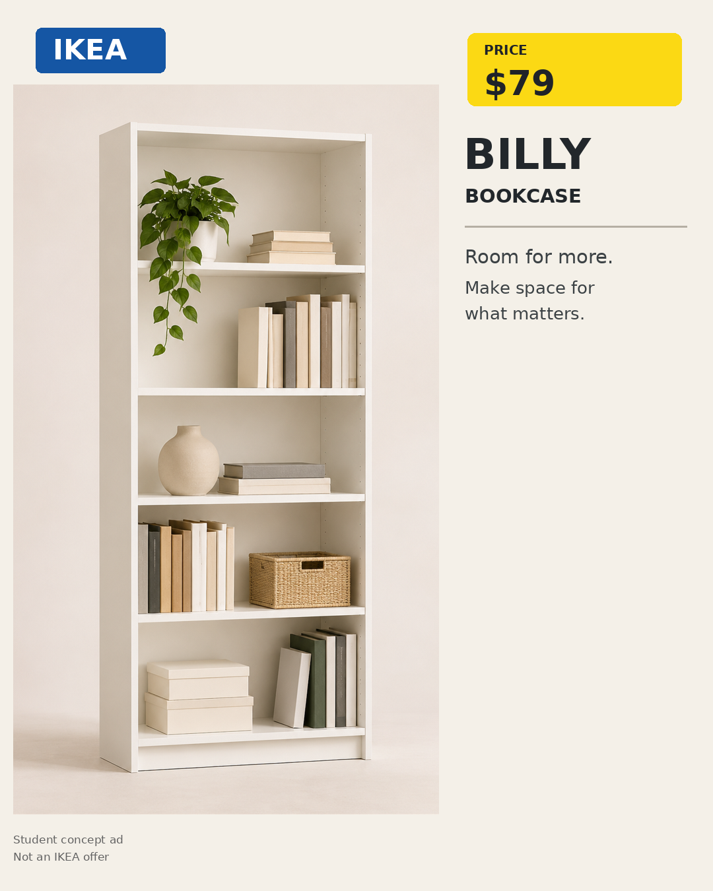
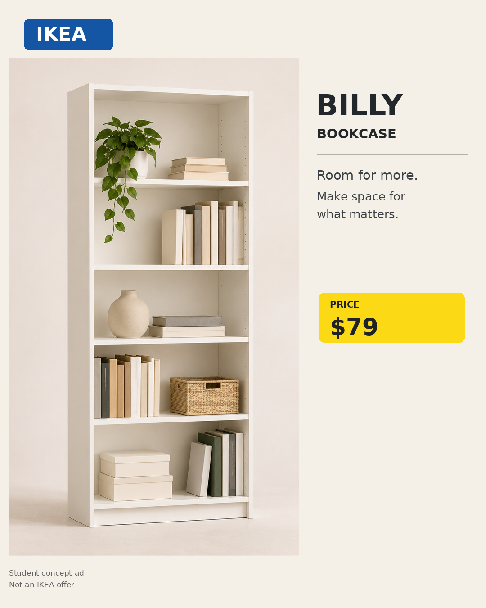
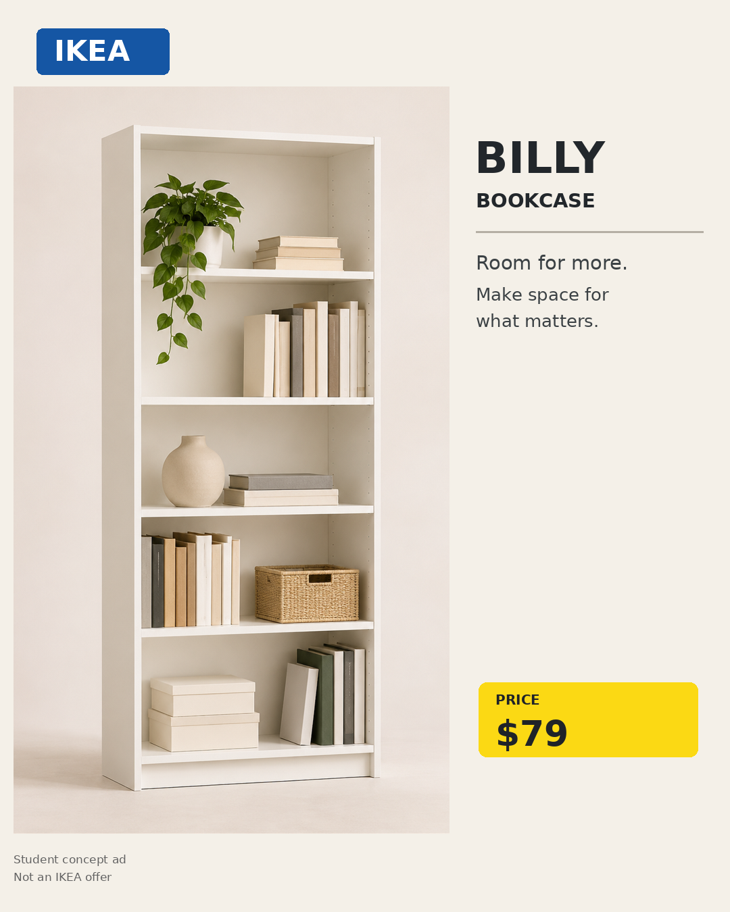
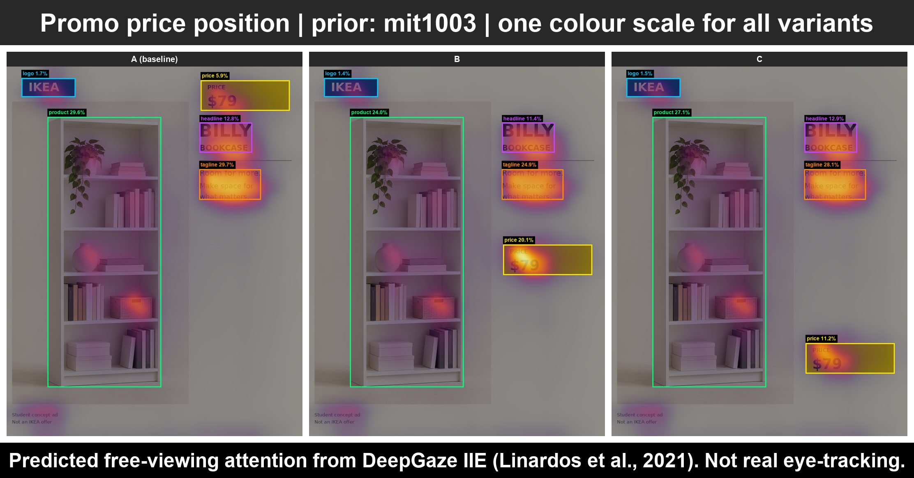
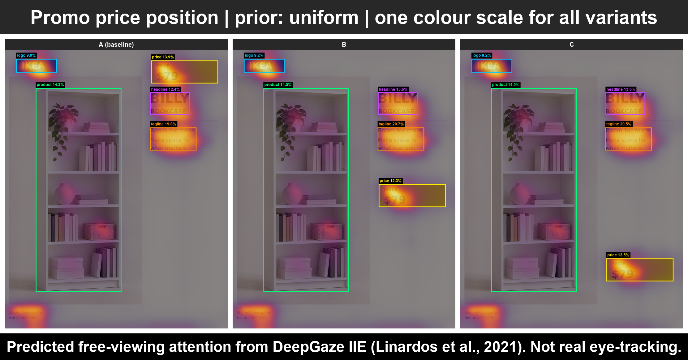
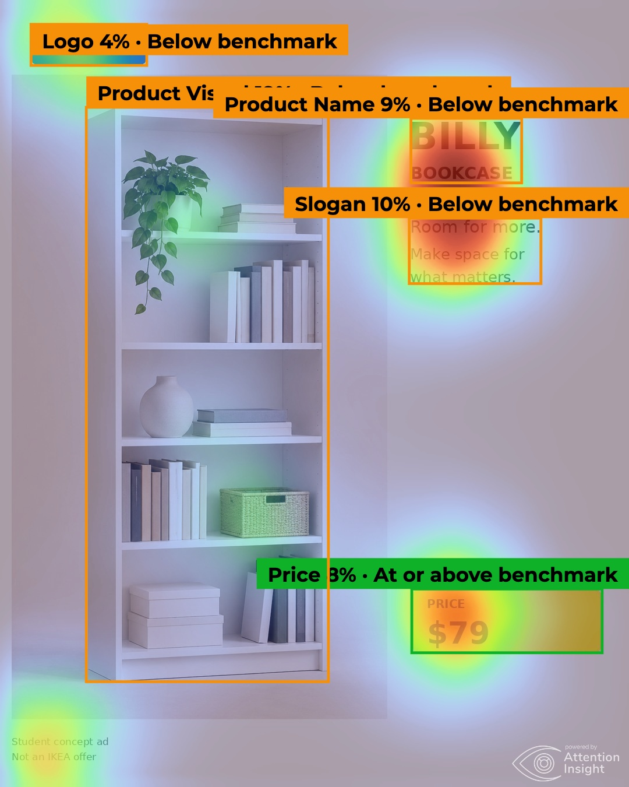
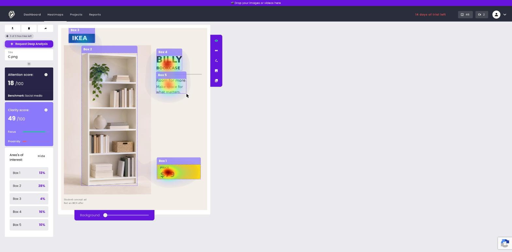

# Promo price position: results from three attention models

Collected on 2026-11-23. This folder holds the ad versions, the areas of interest, the raw exports
from each tool, the processed tables, and a reading of what they say.

> **Everything here is predicted attention from AI models. None of it is real eye-tracking.**
> The numbers say where a model expects people to look. They do not measure what people did.

## The question

One ad for a bookcase, three versions. The only thing that changes is where the yellow price tag
sits: top right (A, the baseline), middle right (B) or bottom right (C).

**Does moving the price tag win it more predicted attention, without taking attention away from
the product?**

| A (baseline) | B | C |
|---|---|---|
|  |  |  |

## The short answer

- **C is the only version where the price gains attention in all three tools.**
- **B gains the most in DeepGaze, but it is the weakest result.** DeepGaze flags it for taking
  attention from the product, and Attention Insight shows no gain at all.
- **The gain in DeepGaze comes from the tag sitting closer to the middle of the ad**, not from the
  tag itself becoming more eye-catching. Without the model's "people look near the centre"
  assumption, neither B nor C beats A.
- **The tools do not agree on the cost to the product.** Brainsight shows none; Attention Insight
  shows a drop in both B and C; DeepGaze shows a drop only in B.

So the evidence leans towards C, and it is not strong. See [What it means](#what-it-means).

## Results

Share of predicted attention on each area, in %. "B − A" and "C − A" are the change from the
baseline in percentage points.

### Price tag

| Tool | A | B | C | B − A | C − A |
|---|---|---|---|---|---|
| DeepGaze IIE (with centre bias) | 5.9 | 20.1 | 11.2 | +14.2 | +5.4 |
| DeepGaze IIE (no centre bias) | 13.9 | 12.3 | 12.5 | −1.5 | −1.3 |
| Attention Insight | 6 | 5 | 8 | −1 | +2 |
| Brainsight | 10 | 12 | 13 | +2 | +3 |

### Product (the bookcase)

| Tool | A | B | C | B − A | C − A |
|---|---|---|---|---|---|
| DeepGaze IIE (with centre bias) | 29.6 | 24.0 | 27.1 | −5.6 | −2.5 |
| DeepGaze IIE (no centre bias) | 14.3 | 14.5 | 14.5 | +0.1 | +0.1 |
| Attention Insight | 24 | 20 | 19 | −4 | −5 |
| Brainsight | 28 | 27 | 28 | −1 | 0 |

### The other areas

| Tool | Area | A | B | C |
|---|---|---|---|---|
| DeepGaze IIE (with centre bias) | headline | 12.8 | 11.4 | 12.9 |
| DeepGaze IIE (with centre bias) | tagline | 29.7 | 24.9 | 28.1 |
| DeepGaze IIE (with centre bias) | logo | 1.7 | 1.4 | 1.5 |
| Attention Insight | headline | 10 | 10 | 9 |
| Attention Insight | tagline | 10 | 10 | 10 |
| Attention Insight | logo | 4 | 4 | 4 |
| Brainsight | headline | 20 | 17 | 16 |
| Brainsight | tagline | 9 | 10 | 10 |
| Brainsight | logo | 4 | 4 | 4 |

The full table, with every metric, is `6_all_tools/cross_tool_long.csv`. The compact one above is
`6_all_tools/attention_pct_by_tool.csv`.

### The key test (DeepGaze)

The rule was fixed before the model ran: a version passes if the price share goes up **and** the
product share does not fall by more than 10% of its baseline value.

| Version | Price change | Product change (% of baseline) | Verdict |
|---|---|---|---|
| B | +14.2 points | −18.8% | price up; **product drop flagged** |
| C | +5.4 points | −8.3% | price up; product held |

C passes, but −8.3% is close to the −10% line.

### What the heatmaps look like

DeepGaze, all three versions on one colour scale, with the model's centre bias:



The same without the centre bias. The price tag is about equally bright in all three:



The commercial tools, version C:

| Attention Insight | Brainsight |
|---|---|
|  |  |

## What it means

**1. Position matters through the centre, not through the tag.** DeepGaze combines two things: how
eye-catching each part of the image is, and a general tendency for people to look near the middle.
With both, B's tag (nearest the middle) gets 20% and A's (in the top corner) gets 6%. With only the
first, all three get about 12–14%. The tag is equally eye-catching wherever it sits; what changes
is how close it is to where the model expects eyes to go anyway. That is a reasonable assumption
about viewers, but it is an assumption built into the model, not something measured on this ad.

**2. B's gain is paid for by the product, in DeepGaze.** In B the tag sits level with the middle of
the bookcase and the product loses almost a fifth of its share. That breaks the rule we set.

**3. C is the consistent one.** Price is up in DeepGaze (+5.4), Attention Insight (+2) and
Brainsight (+3), and DeepGaze's product share stays inside the limit.

**4. But the product result is not agreed.** Attention Insight shows the product falling from 24%
to 19% in C, a bigger fall than in B. Brainsight shows no change. One tool out of three supports
"C costs the product nothing" clearly, one disagrees, one is in between.

**5. The commercial tools' differences are small.** They report whole percentages, so a change of 1
point (Attention Insight's price in B) cannot be told apart from rounding. Changes of 2–3 points
are only just readable.

**A fair one-sentence summary for the report:** moving the price tag lower or more central raised
its predicted attention in most of the model runs, most consistently for the bottom-right
position, but the size of the effect depends on each model's assumptions and the models disagree
on whether the product loses attention.

## How to read the numbers

| Term | Meaning |
|---|---|
| Area of interest (AOI) | A rectangle drawn around one element of the ad. There are five: price, product, logo, headline, tagline. |
| Attention % (share) | Of all the attention the model predicts for the ad, the part that falls inside that rectangle. |
| rest | Everything outside the five rectangles: the photo background, empty space, the small print. DeepGaze only. |
| Centre bias | The model's built-in expectation that people look more at the middle of an image. |
| No centre bias | The same model with that expectation switched off. A check on whether a result depends on it. |
| Density | Attention % divided by the area's size in %. Above 1 means it draws more than its size alone would. |
| First-look order | Areas ranked by their single brightest point. A rough guide to what stands out first, not a real viewing sequence. |
| Jitter check | Every box edge moved at random by up to 5%, 200 times, to see if a conclusion depends on exactly where a box was drawn. |
| Clarity / attention score | Each tool's own single score for the whole ad. The definitions differ, so never compare them across tools. |

Three rules when using these numbers:

1. **Compare directions, not values, across tools.** Each tool scales attention its own way.
2. **Within one tool, compare versions.** That is what the design supports.
3. **Say "predicted" every time.** No one was shown these ads.

## How the pieces fit together

```text
1_ads          the three ad versions (clean images, exactly as uploaded to every tool)
   │
2_aois         five rectangles per version, fixed and locked BEFORE any model ran
   │
   ├── 3_deepgaze           open-source model, run locally; full tables and checks
   ├── 4_attention_insight  commercial tool; same boxes drawn by hand
   └── 5_brainsight         commercial tool; same boxes drawn by hand
   │
6_all_tools    one table with every tool's numbers side by side
```

The same clean images and the same five rectangles went into every tool. The rectangles were
locked before the first heatmap existed, so they could not be adjusted to suit a result.

## What is in each folder

### `1_ads/`

`A.png`, `B.png`, `C.png`: the three versions, 1080 × 1350 px. Outside the price tag they are
identical pixel for pixel, and the tag itself is identical in all three. `base_no_price.png` is the
same ad with no tag.

### `2_aois/`

- `A.json`, `B.json`, `C.json`: the rectangles, as `[left, top, right, bottom]` in pixels.
- `aoi_boxes.csv`: the same rectangles in pixels and in % of the image.
- `previews/`: each version with its rectangles drawn on, for checking by eye.
- `aoi_lock.json`: the record that the rectangles were fixed before the model run.

Product, logo, headline and tagline are the same rectangle in every version. Only the price
rectangle moves, and it keeps its size.

| Area | What it covers |
|---|---|
| price | the yellow tag |
| product | the bookcase itself, not the photo around it |
| logo | the blue logo panel |
| headline | "BILLY BOOKCASE" |
| tagline | "Room for more. Make space for what matters." |

### `3_deepgaze/`

DeepGaze IIE, an open-source research model, run on our own computer.

- `report.md`: the full written report from the pipeline. Start here for detail.
- `panel.png`, `panel_no_centerbias.png`: the three versions side by side.
- `heatmaps/`: per version, the heatmap alone and the heatmap with the rectangles and shares.
- `tables/`:

| File | Contents |
|---|---|
| `A_aoi.csv`, `B_aoi.csv`, `C_aoi.csv` | every metric for every area, with and without centre bias |
| `summary.csv` | whole-image scores and first-look order |
| `compare.csv` | each metric in B and C against A |
| `verdict.csv` | the key test: price up? product held? |
| `jitter.csv`, `jitter_stability.csv` | the robustness check |

- `run_log.json`: the model version, date and settings of the run.

The jitter check came out fully stable: in all 200 redraws, the order of the versions and the
product flags stayed the same.

### `4_attention_insight/`

Settings: asset type Advertising, channel Social Ads, objective Product Highlight.

- `A/`, `B/`, `C/`: `aoi_data.csv` (the percentages and the box positions), the tool's images
  (`heatmap`, `saliency`, `focus`, `contrast`, `aoi`, `original`) and its PDF report.
- `screenshots/`: the tool's screens, as proof of use.

The tool's names for our areas: Product Visual = product, Price = price, Product Name = headline,
Slogan = tagline, Logo = logo. In the tool, the analyses for B and C are called "B redraw" and
"C redraw": the first attempt copied A's price box onto them, so both were redrawn and re-run.

Its overall score was 69 out of 100 for all three versions, so it does not separate them.

One oddity to be aware of: for version A the five areas add up to 54%, while the tool's own
summary says 41% of attention lands on the marked areas. Its area percentages are therefore not
simple slices of one total, and we do not know exactly how they are calculated.

### `5_brainsight/`

Settings: type Social media.

- `A/`, `B/`, `C/`: the tool's heatmap, gaze plot, peek-through and template images.
- `aoi_values.csv`, `image_scores.csv`: the numbers, **typed by hand from the screenshots**,
  because the tool has no data export for areas.
- `screenshots/`: the screens the numbers were read from.

The tool numbers boxes in drawing order: Box 1 price, Box 2 product, Box 3 logo, Box 4 headline,
Box 5 tagline.

| Version | Attention score | Clarity score |
|---|---|---|
| A | 17 | 56 |
| B | 20 | 66 |
| C | 18 | 49 |

### `6_all_tools/`

- `cross_tool_long.csv`: one row per tool, version, area and metric. The format to use for any
  chart or table in the report.
- `attention_pct_by_tool.csv`: only the attention shares, one row per tool and area, with the
  change from A.

## Limits to state in the report

- **No people were involved.** These are model predictions of free viewing, with no task and no
  purchase intent.
- **Three versions of one ad.** The result may not carry to other layouts, products or brands.
- **The tag's surroundings change with its position.** In A it sits next to the logo and headline;
  in B and C it sits in empty space. Part of any difference may be isolation, not height.
- **Hand-drawn boxes in the commercial tools.** Every edge is within 2 px of the locked rectangle,
  which is far smaller than the 5% tested by the jitter check.
- **Whole-percent values from the commercial tools**, and for Brainsight read from the screen.
- **The commercial models are closed.** We cannot check how their numbers are produced.
- **The price-tag AOI boxes were proposed by an AI model and confirmed by a person**, then locked.
