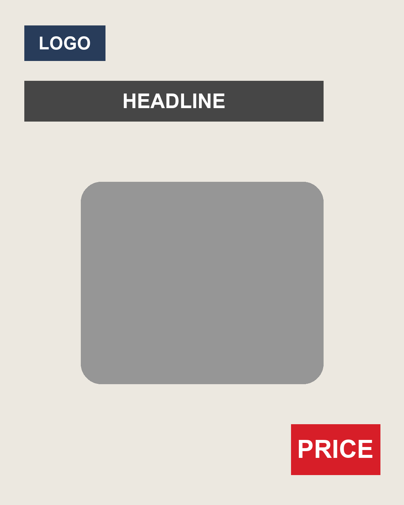
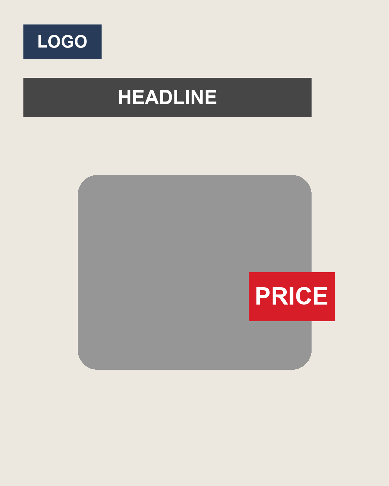
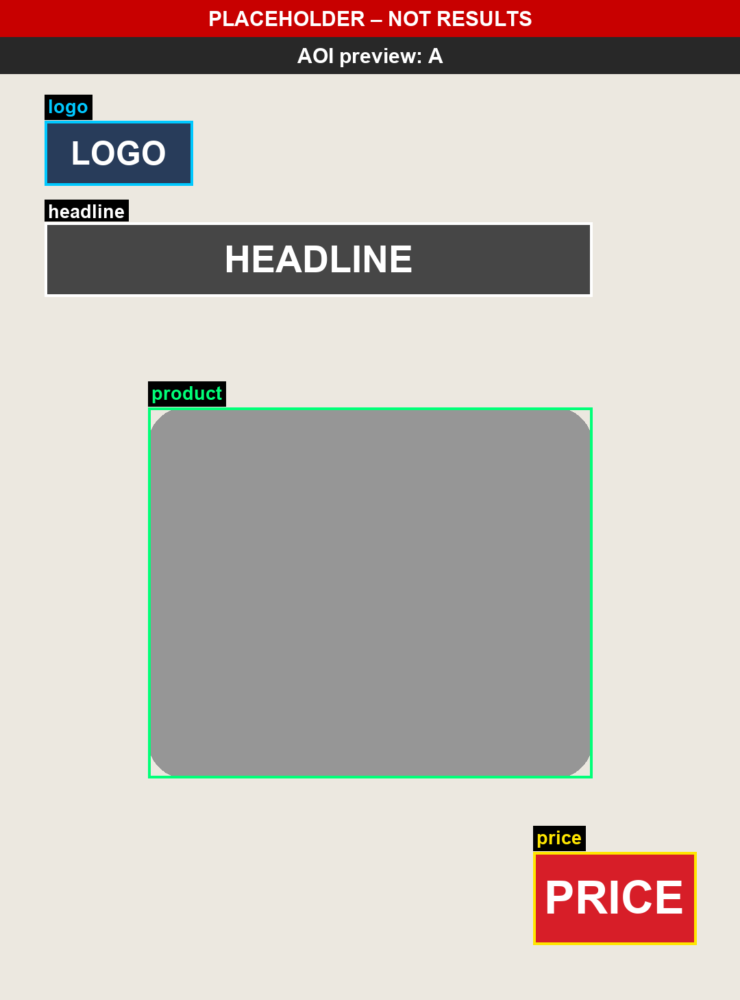
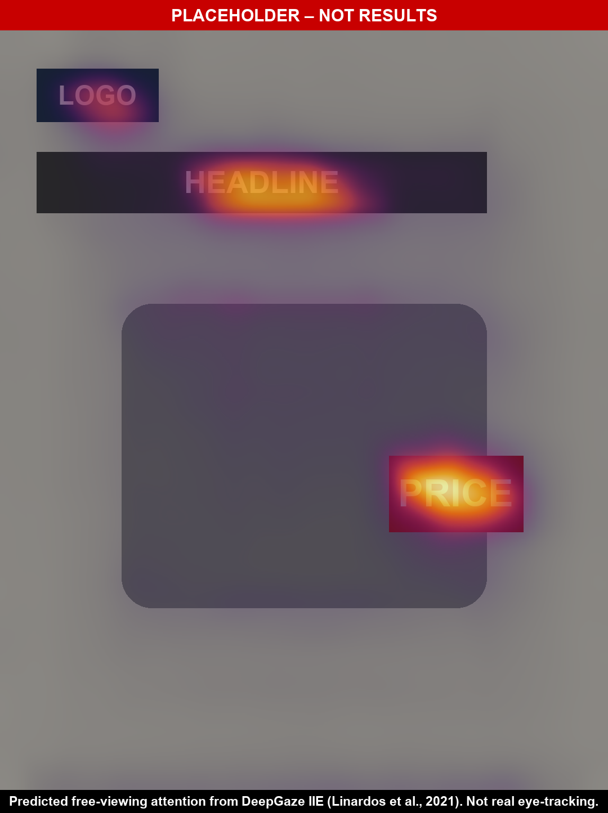
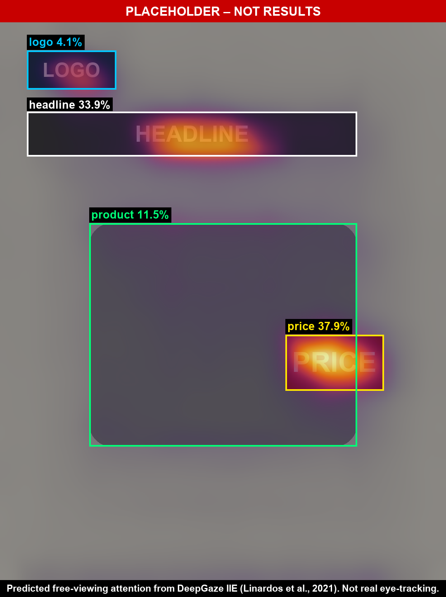
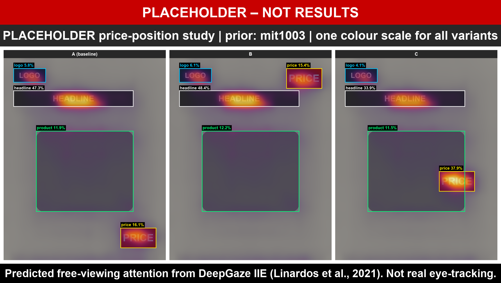
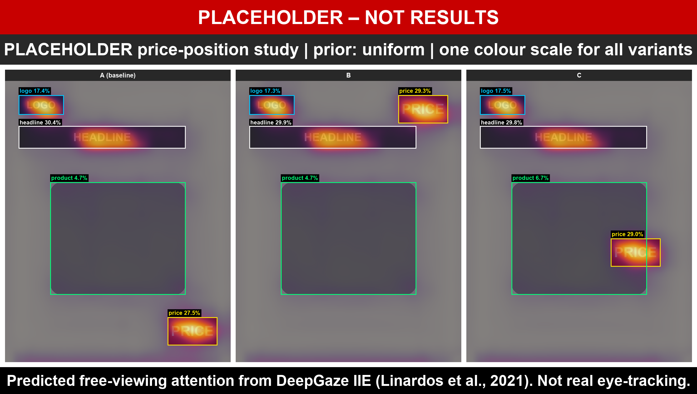

# CW2 update: attention tools (22 November 2026)

Repository: <https://github.com/00017501/glancelab-deepgaze-attention>

## In short

- **DeepGaze IIE is set up and working.** It runs on my laptop, and the whole analysis has been tested end to end on dummy images.
- **The online platforms are in progress.** I am getting access to Attention Insight and to the third tool (Neurons Predict or Expoze). No numbers from them yet.
- **What I need from the group** is at the bottom: mainly the final ad versions and a few decisions.

> Every picture and number below comes from **dummy images** (grey boxes, not our ads). They show what the tool gives us. They are not results.
>
> Also: all of these tools give **predicted** attention from a model. None of it is real eye-tracking, and the report has to say so.

## Where each tool stands

| Tool | Status | How we get its numbers |
|---|---|---|
| DeepGaze IIE | Set up, tested on dummy images | Runs on my laptop; tables and images come out automatically |
| Attention Insight | Getting access | Upload each ad on the website, copy the numbers out by hand |
| Neurons Predict or Expoze | Getting access; we still need to pick one | Same: upload, copy by hand |

## What DeepGaze is

DeepGaze IIE is a free research model (Linardos et al., 2021) trained on real eye-tracking data. You give it an image and it predicts where people are likely to look in the first few seconds of free viewing. The answer is a heatmap: brighter means more predicted attention.

It is the same kind of prediction the commercial tools sell. The difference is that it is open, so we can state exactly which version and settings we used, and anyone can rerun it.

## How it works for our study

Our question: **where should the promo price go so it is noticed, without taking attention away from the product?** We test versions of one ad that are identical except for the price position.

**1. The ad versions go in.** One image per version, all the same size. Version A is the baseline (the usual price position). The dummy ones:

| A (baseline) | B | C |
|:---:|:---:|:---:|
|  |  |  |

**2. We mark the areas we care about.** These are called AOIs (areas of interest): price, product, logo and headline. Product, logo and headline are the same box in every version; only the price box moves. Everything outside the boxes counts as "rest".



For the real ads, an AI model (Claude) proposes the boxes from the image, and a person checks every box by eye and corrects it before it is accepted. For the versions other than the baseline, only the price box is taken from the AI; the other boxes are copied from the baseline so they stay identical. This is the exact prompt it is given (the image size is filled in automatically):

```text
You are annotating areas of interest (AOIs) on a static retail advertisement for an
attention study. The image is {WIDTH} x {HEIGHT} pixels.

Find each of these elements if present, and give a tight bounding rectangle for each
in image pixel coordinates [x0, y0, x1, y1] (x0,y0 = top-left; x1,y1 = bottom-right):
- price: the promotional price tag (the price figure with its own badge, panel or sticker)
- product: the main product being advertised (the whole object, not the room around it)
- logo: the brand logo or wordmark
- headline: the main title text

Rules:
1. Name the four AOIs exactly "price", "product", "logo" and "headline", with the matching type.
2. Omit any element that is not in the image. Do not invent one.
3. The product, logo and headline rectangles must not overlap each other. If two touch, split
   the boundary between them. The price rectangle may overlap another element when the price
   tag really sits on top of it.
4. Include a text element's own background panel or banner, but not empty space around it.
5. Use one rectangle per AOI unless the element is clearly in separate pieces.
```

This is an AI-assisted step, so it has to be disclosed in the report together with this prompt.

The boxes are fixed and locked **before** the model runs, and the tool refuses to run if they are changed afterwards. This matters for the report: nobody can say we moved a box after seeing a heatmap to get a nicer number.

**3. The model predicts a heatmap for each version**, and the tool adds up how much of the predicted attention falls inside each box.

| Heatmap | Heatmap with the boxes and their share of attention |
|:---:|:---:|
|  |  |

**4. Every version is compared with baseline A.**

## What it gives us

**A side-by-side figure** of all versions on one colour scale. This is the picture most likely to go in the report.



**A table per version.** Dummy version A:

| Area | Share of attention | Share of the image | Density | Rank |
|---|---|---|---|---|
| Headline | 47.3% | 5.9% | 8.0 | 1 |
| Price | 16.1% | 2.2% | 7.3 | 2 |
| Product | 11.9% | 24.0% | 0.5 | 3 |
| Logo | 5.8% | 1.4% | 4.2 | 4 |
| Rest | 18.9% | 66.5% | 0.3 | – |

- **Share of attention**: how much of all predicted attention lands in that area. Adds up to 100%.
- **Density**: share of attention divided by share of the image. Above 1 means the area pulls more attention than its size alone would give. It makes a small price tag comparable with a big product photo.
- **Rank**: order by share. There is also a "first look" order (which area has the strongest hot spot), but it is only a rough guess, not a real viewing path.

Per version we also get a **clarity score** (is attention focused on a few spots or spread everywhere).

**The key test**: for each version against the baseline, did the price gain attention, and did the product keep its attention? Dummy values:

| Version | Price share | Change vs A | Product change vs A | Verdict |
|---|---|---|---|---|
| B | 15.4% | −0.7 points | +2.8% | price not up; product held |
| C | 37.9% | +21.8 points | −3.0% | price up; product held |

The product counts as "held" unless its share drops by more than 10% of what it had in the baseline. That 10% is a starting value I chose; the group can change it, but only **before** we run the real ads.

**Two checks that make the result more trustworthy:**

- **Centre check.** People tend to look at the middle of any image, and the model builds that in. So a price moved toward the middle gains attention partly just for being central. The tool therefore runs everything a second time with that effect switched off. In the dummy run, version C's gain of +21.8 points shrank to +1.5 without it: almost all of the "win" was position on the page, not the price standing out. We will need this when we interpret the real ads.

  

- **Box check.** The boxes are nudged slightly (up to 5%) 200 times, to confirm the conclusion does not depend on exactly where a box edge was drawn.

**A shared table for all three tools.** One spreadsheet (CSV) with the columns `tool, variant, aoi, metric, value, scale, run_date, version`. The DeepGaze rows are already filled in. The rows for Attention Insight and the third tool are there but empty, ready to type their numbers into:

| tool | variant | aoi | metric | value | scale |
|---|---|---|---|---|---|
| deepgaze_iie | A | price | attention_pct | 16.13 | 0-100 % of predicted attention |
| attention_insight | A | price | attention_pct | | 0-100 % of attention |

There is also a written summary of the results and a run record (model version, settings, date) for the appendix.

## How we use it together with the other tools

1. The same ad files go into all three tools.
2. The same boxes are drawn in all three. DeepGaze outputs a list of every box as a percentage of the image (left, top, width, height), so the boxes can be redrawn identically on the websites.
3. Each tool's numbers go into the one shared table.
4. We compare **direction and ranking** across tools (does each tool say the same version is best for the price? does the product hold in each?), not the raw numbers, because every tool uses its own scale.

If the three tools agree, that is a stronger finding than any one of them. If they disagree, that is also worth reporting.

## What it cannot tell us

- It predicts where people look. It does not measure whether they **remember** the price. The "remembered" half of our question needs another argument or source.
- It is a prediction for an average viewer in the first few seconds, with no task and no interest in buying.
- It is not real eye-tracking. This goes next to every figure and number we use.

## What I need from the group

1. **The final ad versions**: exported from the same design file, exactly the same pixel size, with only the price moved. At least three; more is fine.
2. **Which version is the baseline** (the conventional price position).
3. **The third tool**: Neurons Predict or Expoze?
4. **What each online tool actually exports** (which scores, on what scale), so the shared table has the right rows.
5. **The product threshold**: is "a drop of more than 10%" acceptable? We must fix it before the real run.

Once I have the images, the DeepGaze side should take under an hour, including checking the boxes.

## Setting it up yourself

You can also run it on your own laptop (macOS or Linux). Everything is in the repository:

- Setup instructions: <https://github.com/00017501/glancelab-deepgaze-attention#readme>
- Step-by-step guide, with an example of what every step produces: <https://github.com/00017501/glancelab-deepgaze-attention/blob/main/docs/ANALYSIS_GUIDE.md>

Follow the setup first, then go through the guide. It includes the dummy images, so you can try the whole thing before the real ads exist.

Reference: Linardos, A., Kümmerer, M., Press, O., & Bethge, M. (2021). DeepGaze IIE: Calibrated prediction in and out-of-domain for state of the art saliency modeling. *ICCV 2021*.
